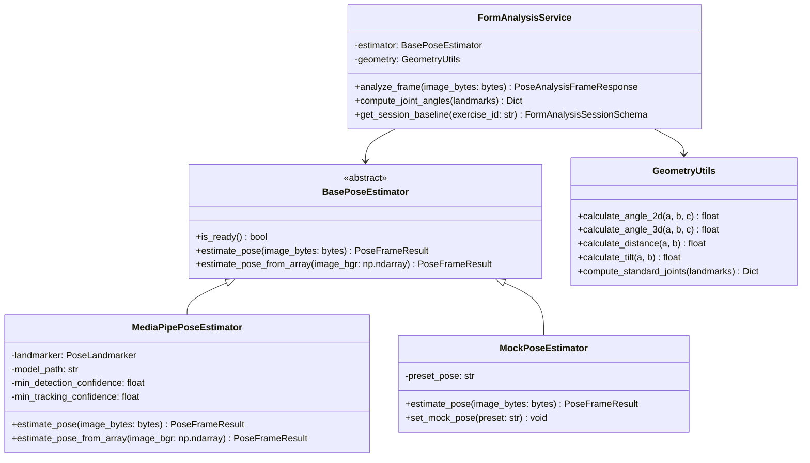

# PHASE 9A — AI FORM ANALYSIS & COMPUTER VISION FOUNDATION
## Comprehensive Architectural Specification & Implementation Plan

**Version:** 1.0.0  
**Status:** DRAFT — AWAITING USER APPROVAL  
**Author:** AI Pair Programmer (DeepMind Antigravity)  
**Target Milestone:** Phase 9A — Computer Vision & Pose Estimation Engine Foundation  
**System Boundary:** Backend CV Foundation, Geometry Mathematics, Pose Estimation Abstraction, Schemas, Core Endpoints, Test Suite  

---

## 1. Executive Overview

Phase 9 introduces **Real-Time AI Form Analysis & Computer Vision** to AI FITNESS, enabling athletes to verify exercise technique, joint trajectory, and biomechanical safety using camera vision.

To ensure stability, reliability, and continuous zero-regression compliance with the frozen Phases 1–8, Phase 9 is bifurcated into distinct sub-phases:
- **Phase 9A (This Milestone):** Computer Vision Foundation, Pose Landmark Extraction, Geometric Joint-Angle Mathematics, Confidence Thresholding, Backend Schemas, and Stateless Frame Analysis API.
- **Phase 9B (Subsequent Milestone):** Exercise-specific form rules (e.g. Squat depth, Bench Press elbow flare, Deadlift spine neutrality), rep-counting state machines, and real-time frontend webcam canvas overlay.
- **Phase 9C (Subsequent Milestone):** Multi-set workout telemetry persistence, session history aggregation, and audio/voice coaching feedback.

Phase 9A focuses strictly on building the **mathematically robust, deterministic, and modular foundation** without breaking existing Phase 1–8 systems or modifying the approved frontend UI.

---

## 2. Technology Stack & Dependency Analysis

### 2.1 Python & Computer Vision Core
- **Python Version:** Python 3.13.5 (Verified installed on host system)
- **OpenCV (`opencv-contrib-python` 5.0.0 / `opencv-python`):** High-performance image decoding, color-space conversion (BGR $\leftrightarrow$ RGB), downscaling, coordinate translation, and buffer management.
- **MediaPipe (`mediapipe` 0.10.35):** Google's state-of-the-art ML vision framework.
  - *Critical Discovery:* In MediaPipe 0.10+ under Python 3.13, Google migrated from the legacy `mp.solutions.pose` pipeline to the modern **MediaPipe Tasks Vision API** (`from mediapipe.tasks.python import vision`).
  - Phase 9A implements Google's official `vision.PoseLandmarker` task architecture.
- **NumPy (`numpy` 2.2.6):** High-speed vectorized linear algebra, dot products, vector norms, and trigonometric operations.
- **Pydantic 2.8+ / FastAPI 0.115+:** Strict schema validation, automatic OpenAPI generation, and async non-blocking endpoint execution.

### 2.2 Dependency Specification (`backend/requirements.txt`)
The current dependencies in `backend/requirements.txt` will be updated to formally lock the computer vision dependencies:
```txt
fastapi>=0.115.0
uvicorn[standard]>=0.30.0
pydantic>=2.8.0
pydantic-settings>=2.4.0
firebase-admin>=6.5.0
httpx>=0.27.0
pytest>=8.3.0
pytest-asyncio>=0.24.0
python-dotenv>=1.0.0
google-genai>=2.22.0
opencv-contrib-python>=4.10.0,<6.0.0
mediapipe>=0.10.14
numpy>=1.26.0,<3.0.0
python-multipart>=0.0.9
```
*Note: `mediapipe` (0.10.35), `opencv-contrib-python` (5.0.0), and `numpy` (2.2.6) are already satisfied in the local environment.*

---

## 3. Mathematical & Geometric Specifications

All biomechanical joint assessments depend upon accurate, numerically stable vector calculations.

### 3.1 3-Point Joint Angle Formula (Planar & Spatial)
Given three anatomical landmarks:
- Point $A = (x_a, y_a)$ (Proximal joint, e.g., Shoulder)
- Point $B = (x_b, y_b)$ (Vertex joint, e.g., Elbow)
- Point $C = (x_c, y_c)$ (Distal joint, e.g., Wrist)

The vectors representing the limb segments are:
$$\vec{v}_1 = \vec{BA} = (x_a - x_b, y_a - y_b)$$
$$\vec{v}_2 = \vec{BC} = (x_c - x_b, y_c - y_b)$$

The interior angle $\theta$ at vertex $B$ is calculated using the dot product:
$$\cos(\theta) = \frac{\vec{v}_1 \cdot \vec{v}_2}{\|\vec{v}_1\| \|\vec{v}_2\|}$$

$$\theta = \arccos\left(\text{clamp}\left(\frac{\vec{v}_1 \cdot \vec{v}_2}{\|\vec{v}_1\| \|\vec{v}_2\|}, -1.0, 1.0\right)\right) \times \frac{180^\circ}{\pi}$$

#### Numerical Stability & Guardrails:
1. **Zero-Division Protection:** If $\|\vec{v}_1\| = 0$ or $\|\vec{v}_2\| = 0$ (collapsed or overlapping keypoints), the function returns `None` or flags a zero-length error rather than throwing `ZeroDivisionError`.
2. **Domain Clamping:** Floating-point rounding errors can cause $\frac{\vec{v}_1 \cdot \vec{v}_2}{\|\vec{v}_1\| \|\vec{v}_2\|}$ to slightly exceed $1.0$ (e.g. $1.0000000000000002$), which crashes `math.acos` with `ValueError: math domain error`. The cosine ratio is strictly clamped to $[-1.0, 1.0]$ via `max(-1.0, min(1.0, ratio))`.
3. **Bounded Output:** Calculated angles are guaranteed to lie within $[0.0^\circ, 180.0^\circ]$.

### 3.2 3D Spatial Angles
For exercises where perspective distortion occurs (e.g., sagittal vs. frontal plane offset), 3D landmarks incorporating relative depth $z$ are evaluated:
$$\vec{v}_{1,3D} = (x_a - x_b, y_a - y_b, z_a - z_b)$$
$$\vec{v}_{2,3D} = (x_c - x_b, y_c - y_b, z_c - z_b)$$
$$\theta_{3D} = \arccos\left(\text{clamp}\left(\frac{\vec{v}_{1,3D} \cdot \vec{v}_{2,3D}}{\|\vec{v}_{1,3D}\| \|\vec{v}_{2,3D}\|}, -1.0, 1.0\right)\right) \times \frac{180^\circ}{\pi}$$

### 3.3 Segment Tilt & Vertical Alignment
To assess spine alignment, pelvic tilt, and bar tilt:
$$\alpha_{\text{vertical}} = \arctan2(\Delta x, \Delta y) \times \frac{180^\circ}{\pi}$$
$$\alpha_{\text{horizontal}} = \arctan2(\Delta y, \Delta x) \times \frac{180^\circ}{\pi}$$

### 3.4 Landmark Confidence & Visibility Aggregation
Each detected landmark $L_i$ carries a visibility confidence $c_i \in [0.0, 1.0]$. For any calculated angle involving keypoints $(A, B, C)$:
$$c_{\text{joint}} = \min(c_A, c_B, c_C)$$
If $c_{\text{joint}} < \tau_{\text{confidence}}$ (default threshold: $0.5$), the joint measurement is tagged as `occluded = True` or returned with low-confidence status, preventing false coaching alerts caused by self-occlusion or poor lighting.

---

## 4. Canonical 33-Pose Landmark Topology

MediaPipe tracks 33 standardized full-body landmarks (BlazePose topology):

| Index | Canonical Name | Body Segment | Core Utilization in Phase 9 |
|---|---|---|---|
| 0 | `NOSE` | Head | Head alignment & gaze direction |
| 11, 12 | `LEFT_SHOULDER`, `RIGHT_SHOULDER` | Upper Torso | Shoulder leveling, bench press chest contact, push-up depth |
| 13, 14 | `LEFT_ELBOW`, `RIGHT_ELBOW` | Upper Arm | Elbow flexion/extension, bench flare angle |
| 15, 16 | `LEFT_WRIST`, `RIGHT_WRIST` | Forearm / Grip | Wrist stacking, bar tracking |
| 23, 24 | `LEFT_HIP`, `RIGHT_HIP` | Pelvis / Core | Hip hinge, squat depth, pelvic tilt, spine baseline |
| 25, 26 | `LEFT_KNEE`, `RIGHT_KNEE` | Lower Body | Knee flexion, valgus/varus detection, squat parallel |
| 27, 28 | `LEFT_ANKLE`, `RIGHT_ANKLE` | Lower Leg | Heel tracking, knee-over-toe ratio |
| 29, 30 | `LEFT_HEEL`, `RIGHT_HEEL` | Foot | Heel rise detection, squat stability |
| 31, 32 | `LEFT_FOOT_INDEX`, `RIGHT_FOOT_INDEX` | Foot / Toe | Stance width, foot angle |

---

## 5. Architectural Design & Class Hierarchy

Phase 9A follows the proven dependency-inversion pattern established in Phase 8 (`BaseLLMClient` $\rightarrow$ `GeminiLLMClient` & `MockLLMClient`):



### Key Design Benefits:
1. **Zero External Network Requests for Unit Tests:** `MockPoseEstimator` enables instant, deterministic execution of 100% of backend tests offline without requiring model file downloads or consuming GPU memory.
2. **Thread Safety:** MediaPipe C++ graph instances are bounded and managed safely within worker threads using `asyncio.to_thread` to ensure FastAPI's async event loop is never blocked by CPU-intensive matrix operations.
3. **Pluggable Architecture:** If future requirements dictate YOLOv8-Pose, RTMPose, or WebAssembly on the edge, the interface remains identical.

---

## 6. Exact File Plan

### 6.1 Files to Create (NEW)

| File Path | Component | Purpose |
|---|---|---|
| [backend/app/services/geometry_utils.py](file:///c:/Users/Suchit/Downloads/Fitness%20App/backend/app/services/geometry_utils.py) | CV Mathematics | Vector math, 2D/3D joint angles, distance, tilt, center of mass, numerical clamping |
| [backend/app/services/pose_estimator.py](file:///c:/Users/Suchit/Downloads/Fitness%20App/backend/app/services/pose_estimator.py) | Pose Engine | `BasePoseEstimator`, `MediaPipePoseEstimator` (Task API), `MockPoseEstimator` |
| [backend/app/services/form_analysis_service.py](file:///c:/Users/Suchit/Downloads/Fitness%20App/backend/app/services/form_analysis_service.py) | Service Layer | Coordinates frame decoding, pose extraction, joint calculations, and baseline data |
| [backend/app/api/v1/endpoints/form_analysis.py](file:///c:/Users/Suchit/Downloads/Fitness%20App/backend/app/api/v1/endpoints/form_analysis.py) | REST API | Endpoints for `/pose/extract`, `/pose/angles`, `/session/{exercise_id}`, `/health` |
| [backend/tests/test_geometry_utils.py](file:///c:/Users/Suchit/Downloads/Fitness%20App/backend/tests/test_geometry_utils.py) | Unit Tests | Tests for right angles, straight lines, zero vectors, collinearity, 3D math, clamping |
| [backend/tests/test_pose_estimator.py](file:///c:/Users/Suchit/Downloads/Fitness%20App/backend/tests/test_pose_estimator.py) | Unit Tests | Tests for `MockPoseEstimator`, landmark topologies, corrupt image handling, confidence filtering |
| [backend/tests/test_form_analysis_api.py](file:///c:/Users/Suchit/Downloads/Fitness%20App/backend/tests/test_form_analysis_api.py) | API Tests | Tests for endpoint validation, multipart upload, base64 payloads, and error codes |

### 6.2 Files to Modify

| File Path | Target Section | Changes |
|---|---|---|
| [backend/requirements.txt](file:///c:/Users/Suchit/Downloads/Fitness%20App/backend/requirements.txt) | Dependencies | Add `opencv-contrib-python`, `mediapipe`, `numpy`, `python-multipart` |
| [backend/app/core/config.py](file:///c:/Users/Suchit/Downloads/Fitness%20App/backend/app/core/config.py) | Settings | Add `CV_MIN_DETECTION_CONFIDENCE`, `CV_MIN_TRACKING_CONFIDENCE`, `CV_MAX_IMAGE_SIZE_BYTES` |
| [backend/app/schemas/form_analysis.py](file:///c:/Users/Suchit/Downloads/Fitness%20App/backend/app/schemas/form_analysis.py) | Schemas | Add `NormalizedLandmarkSchema`, `JointAngleResultSchema`, `PoseAnalysisFrameResponse`, `PoseAnalysisFrameRequest` |
| [backend/app/api/v1/router.py](file:///c:/Users/Suchit/Downloads/Fitness%20App/backend/app/api/v1/router.py) | API Router | Uncomment line 40: `api_router.include_router(form_analysis_router, prefix="/form-analysis", tags=["Form Analysis"])` |

---

## 7. Backend Schemas & Data Contracts

### 7.1 New Pydantic Models in `backend/app/schemas/form_analysis.py`

```python
class NormalizedLandmark(BaseModel):
    index: int
    name: str
    x: float  # Normalized [0.0, 1.0] relative to frame width
    y: float  # Normalized [0.0, 1.0] relative to frame height
    z: float  # Relative depth
    visibility: float  # Confidence [0.0, 1.0]
    presence: Optional[float] = None

class BoundingBox(BaseModel):
    x_min: float
    y_min: float
    width: float
    height: float

class JointAngleResult(BaseModel):
    joint_name: str
    angle_degrees: float
    confidence: float
    vertex_landmark: str
    connected_landmarks: List[str]
    is_occluded: bool = False

class PoseAnalysisFrameRequest(BaseModel):
    image_base64: Optional[str] = None
    exercise_id: Optional[str] = None
    target_joints: Optional[List[str]] = None

class PoseAnalysisFrameResponse(BaseModel):
    landmarks_detected: bool
    landmark_count: int
    landmarks: Dict[str, NormalizedLandmark]
    joint_angles: Dict[str, JointAngleResult]
    bounding_box: Optional[BoundingBox] = None
    overall_confidence: float
    processing_time_ms: float
    model_version: str = "mediapipe-tasks-0.10"
```

---

## 8. FastAPI REST API Specification

### Endpoint 1: `GET /api/v1/form-analysis/health`
- **Purpose:** Health and hardware capability probe for computer vision subsystem.
- **Auth:** Public.
- **Response:**
  ```json
  {
    "status": "ready",
    "engine": "MediaPipe Tasks Vision",
    "backend_provider": "CPU",
    "supported_landmarks": 33,
    "confidence_threshold": 0.5
  }
  ```

### Endpoint 2: `POST /api/v1/form-analysis/pose/extract`
- **Purpose:** Upload single image frame and extract canonical 33 body landmarks.
- **Content-Type:** `multipart/form-data` (file: `image`) OR `application/json` (`image_base64`).
- **Auth:** Optional / Authenticated user.
- **Validation:** Image must be $\le 5\text{ MB}$, valid MIME type (`image/jpeg`, `image/png`, `image/webp`).
- **Response:** `PoseAnalysisFrameResponse` containing landmarks, bounding box, and overall confidence.

### Endpoint 3: `POST /api/v1/form-analysis/pose/angles`
- **Purpose:** Compute standard joint angles (left/right elbows, knees, hips, shoulders) from frame or supplied landmark payload.
- **Content-Type:** `application/json` or `multipart/form-data`.
- **Response:**
  ```json
  {
    "landmarks_detected": true,
    "joint_angles": {
      "left_elbow": {
        "joint_name": "left_elbow",
        "angle_degrees": 89.4,
        "confidence": 0.94,
        "vertex_landmark": "LEFT_ELBOW",
        "connected_landmarks": ["LEFT_SHOULDER", "LEFT_WRIST"],
        "is_occluded": false
      },
      "right_elbow": {
        "joint_name": "right_elbow",
        "angle_degrees": 88.7,
        "confidence": 0.92,
        "vertex_landmark": "RIGHT_ELBOW",
        "connected_landmarks": ["RIGHT_SHOULDER", "RIGHT_WRIST"],
        "is_occluded": false
      }
    },
    "processing_time_ms": 14.2
  }
  ```

### Endpoint 4: `GET /api/v1/form-analysis/session/{exercise_id}`
- **Purpose:** Delivers the initial session structure, baseline metrics, and exercise parameters matching the frontend `FormAnalysisSession` contract.
- **Auth:** Authenticated user.
- **Response:** `FormAnalysisSessionSchema`.

---

## 9. Security, Privacy & Performance

### 9.1 Zero Credential Rule
- The entire computer vision subsystem is **100% on-premise / local execution**.
- Requires **ZERO external API keys**, zero cloud tokens, and zero paid provider quotas (eliminating 429 quota exhaustion risks completely).

### 9.2 Privacy-First Memory Processing
- Raw video frames and camera image uploads are **processed strictly in volatile RAM** and **immediately discarded**.
- Frames are **NEVER persisted to disk, database, logs, or cloud storage**.
- Only derived numerical metrics (angles, reps, timestamps) are ever candidate for persistence.

### 9.3 Denial-of-Service & Payload Protection
- Maximum payload ceiling: Enforce `5 * 1024 * 1024` bytes (5 MB) limit per image upload.
- Dimensions check: Frame buffers exceeding $1920 \times 1080$ are dynamically downscaled using bilinear interpolation before pose inference to bound compute cycles.

### 9.4 Concurrency & Latency Targets
- MediaPipe Pose Lite/Full inference latency: $\le 30\text{–}50\text{ ms}$ per frame on modern CPU.
- Non-blocking execution: `run_in_threadpool` or `asyncio.to_thread` used for all OpenCV/MediaPipe calls to prevent event-loop latency spikes.

---

## 10. Comprehensive Test Strategy

The test plan for Phase 9A guarantees that all newly introduced modules are 100% covered without impacting the existing 232 test suite:

### Test Suite 1: `backend/tests/test_geometry_utils.py`
1. **Right Angle Verification ($90.0^\circ$):** Triangle $(0, 1) - (0, 0) - (1, 0)$ must yield exactly $90.0^\circ$.
2. **Straight Line Verification ($180.0^\circ$):** Collinear points $(-1, 0) - (0, 0) - (1, 0)$ must yield $180.0^\circ$.
3. **Acute Angle ($45.0^\circ$):** $(0, 1) - (0, 0) - (1, 1)$ must yield $45.0^\circ$.
4. **Folded Limb ($0.0^\circ$):** Co-directional rays must yield $0.0^\circ$.
5. **Degenerate / Zero-Length Vectors:** Overlapping points must safely return `None` or raise handled exception rather than `ZeroDivisionError`.
6. **Cosine Clamping:** Vectors with numerical rounding overshoot $> 1.0$ must clamp safely without `ValueError`.
7. **3D Spatial Angles:** Correctly compute angles incorporating depth $z$.
8. **Confidence Minimum Propagation:** Angle confidence must equal $\min(c_A, c_B, c_C)$.

### Test Suite 2: `backend/tests/test_pose_estimator.py`
1. **Mock Pose Estimator Standup:** Verifies deterministic landmark generation for standing, squat, and bench press presets.
2. **Corrupt Image Handling:** Passing corrupt bytes to `estimate_pose` returns clean `landmarks_detected=False` without crash.
3. **Empty / Black Frame Handling:** Returns zero detected landmarks gracefully.
4. **Confidence Thresholding:** Filtering suppresses keypoints below specified confidence cutoff.
5. **Bounding Box Calculation:** Correctly bounds extremities from valid landmarks.

### Test Suite 3: `backend/tests/test_form_analysis_api.py`
1. **Health Endpoint:** `GET /api/v1/form-analysis/health` returns HTTP 200 with engine metadata.
2. **Pose Extract (Multipart):** Uploading synthetic test JPEG returns 33 landmarks.
3. **Pose Extract (Base64):** Submitting base64 image string returns valid landmarks.
4. **Invalid Image Format:** Uploading non-image file (e.g. `.txt`, random bytes) returns HTTP 422 / 400.
5. **Oversized Image Rejection:** Upload exceeding 5MB returns HTTP 413 Payload Too Large.
6. **Joint Angles Endpoint:** Computes angles and returns structured dictionary.
7. **Session Metadata Endpoint:** `GET /api/v1/form-analysis/session/ex_bench_press` returns valid baseline session.

---

## 11. Explicit Boundaries for Phase 9A

### Included in Phase 9A:
- Vector mathematics & 2D/3D joint angle calculation library.
- MediaPipe Tasks Vision Pose Landmarker engine abstraction (`BasePoseEstimator`, `MediaPipePoseEstimator`, `MockPoseEstimator`).
- Confidence filtering and landmark normalization.
- Backend Pydantic models for pose landmarks, joint angles, and frame analysis.
- FastAPI endpoints under `/api/v1/form-analysis/`.
- Full unit and API regression tests.

### Deferred to Phase 9B+:
- Real-time WebRTC / WebSocket streaming pipelines (Phase 9B).
- Exercise-specific rep counting state machines (Squat, Deadlift, Bench Press) (Phase 9B).
- Form violation heuristics (e.g. knee cave, bar drift, butt wink) (Phase 9B).
- Frontend HTML5 `<canvas>` skeleton overlay renderer (Phase 9B).
- Web Audio sound effects / spoken voice alerts (Phase 9C).
- Video recording / clip upload to Firebase Storage (Phase 9C).

---

## 12. Verification & Acceptance Criteria

Phase 9A will be deemed complete and ready for review when:
1. All newly introduced CV and geometry unit tests pass:
   ```bash
   py -m pytest backend/tests/test_geometry_utils.py backend/tests/test_pose_estimator.py backend/tests/test_form_analysis_api.py -v
   ```
2. Existing complete backend regression suite remains 100% compatible.
3. Frontend production build passes with zero errors:
   ```bash
   npm run build
   ```
4. Zero credentials or external cloud dependencies introduced.
5. All image data processed in-memory with zero temporary disk residue.
