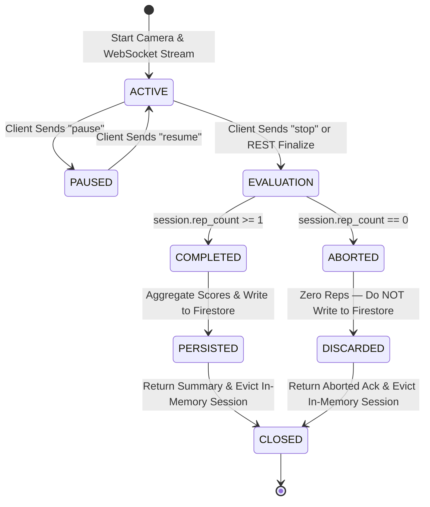

# PHASE 9B.7 — SESSION SUMMARY & HISTORY PLAN
**Phase:** Phase 9B.7  
**Status:** PLANNING ONLY — DO NOT IMPLEMENT YET  
**Date:** 2026-09-14  
**Boundary Constraint:** Phase 9B.7 Planning ONLY. Phase 9C is strictly FORBIDDEN.

---

### 1. Current Architecture Discovered

#### Backend (Python / FastAPI)
- **Phase 9A (CV Foundation)**: `FormAnalysisService` (`backend/app/services/form_analysis_service.py`), `PoseEstimator` (`backend/app/cv/pose_estimator.py`), and `cv_engine.py`. Extracts 33 canonical landmarks and geometric joint angles in volatile memory.
- **Phase 9B.1 (Exercise FSM)**: `ExerciseFSM` (`backend/app/services/exercise_fsm.py`). Implements finite state machines for 5 exercises (`ex_squat`, `ex_bench_press`, `ex_deadlift`, `ex_bicep_curl`, `ex_shoulder_press`). Emits `FSMUpdateResult` with `rep_completed`, `outcome` (COMPLETED, INCOMPLETE, TIMEOUT, NO_REP), and `rom_degrees`.
- **Phase 9B.2 (Form Heuristics)**: `FormHeuristicsService` (`backend/app/services/form_heuristics.py`). Evaluates kinematics against biomechanical rules across 4 categories: ROM (0.40), Joint Alignment / Technique (0.35), Symmetry (0.15), and Stability (0.10). Missing or low-confidence keypoints yield `NOT_OBSERVABLE` or `INSUFFICIENT_CONFIDENCE`, not false deductions.
- **Phase 9B.3 (Deterministic Scoring)**: `FormScoringEngine` (`backend/app/services/form_scoring.py`). Evaluates `RepetitionScore` with status (`VALID`, `INCOMPLETE`, `INVALID`, `INSUFFICIENT_DATA`) and `SetScoreSummary`. Overall score is the arithmetic mean of valid reps only. Null scores are preserved when valid reps = 0.
- **Phase 9B.4 (Session Manager)**: `FormSessionManager` (`backend/app/services/form_session_manager.py`). Ephemeral, thread-safe, in-memory coordinator managing `FormAnalysisSession`. Keeps bounded history (8-frame observation sliding window, max 100 rep records). Currently evicts sessions on stop/expiry without database writes.
- **Phase 9B.5 (WebSocket Streaming)**: `form_analysis_ws.py` (`backend/app/api/routes/form_analysis_ws.py`) and `form_stream_service.py`. Binary frame protocol (`>16sQQ`), rate-limiting ($\le 25$ FPS), monotonic sequence validation, Firebase ID token authentication via `?token=...`. When a `"stop"` control message is received, it sends `WSStoppedMessage` and immediately evicts the session from `FormSessionManager`.
- **Firebase & Repository Patterns**: `backend/app/core/firebase.py` initializes Firebase Admin SDK. Repositories (`workout_repository.py`, `nutrition_repository.py`, `user_repository.py`) use `get_firestore_db()`, user-scoped collections (`users/{uid}/...`), and maintain an in-memory dictionary fallback (`_in_memory_sessions`) for testing when Firestore is uninitialized.

#### Frontend (React / TypeScript)
- **Form Analysis Workspace**: `src/pages/app/FormAnalysisPage.tsx` renders a dual-column layout (8 columns left, 4 columns right).
- **Camera Viewport**: `src/components/form-analysis/CameraLiveViewport.tsx` renders live camera feed, canvas skeleton overlay, FSM state pill, authoritative rep count, form score pill, and stream controls (Start, Pause, Resume, Stop, Mirror).
- **Stream Hook**: `src/hooks/useFormAnalysisStream.ts` coordinates camera acquisition, offscreen canvas capture, 25 FPS pacing, binary packet packing, and WebSocket communication.
- **History Card**: `src/components/form-analysis/AnalysisHistoryCard.tsx` currently displays static mock items from `mockFormAnalysisSession.history`.
- **UI Components**: Standard `Modal` (`src/components/ui/Modal.tsx`), `Button`, `Skeleton`, and `Badge` components are established across the app.

---

### 2. Exact Scope

The purpose of Phase 9B.7 is to persist and display completed form-analysis sessions.

#### In Scope:
1. **Deterministic Finalization**: Explicit rules distinguishing `COMPLETED` sessions from `ABORTED` sessions.
2. **Firestore Repository**: Create `FormAnalysisRepository` (`backend/app/repositories/form_analysis_repository.py`) managing `users/{uid}/form_analysis_sessions/{session_id}` with in-memory test fallback.
3. **HTTP API Endpoints**:
   - `GET /api/v1/form-analysis/history` (paginated list of user sessions)
   - `GET /api/v1/form-analysis/history/{session_id}` (detailed session record)
   - `POST /api/v1/form-analysis/sessions/{session_id}/finalize` (idempotent REST finalization)
4. **WebSocket Integration**: Update `form_analysis_ws.py` to auto-finalize sessions when clean `"stop"` is received.
5. **Frontend API Integration**: Update `src/services/formAnalysisService.ts` to call real history endpoints.
6. **Frontend History Hook**: Create `src/hooks/useFormAnalysisHistory.ts` to manage loading, empty, and data states.
7. **Frontend History Card**: Update `src/components/form-analysis/AnalysisHistoryCard.tsx` to render real sessions with genuine empty states.
8. **Frontend Detail Modal**: Create `src/components/form-analysis/SessionDetailModal.tsx` showing rep breakdown, category scores, and deterministic feedback.

#### Strictly Out of Scope:
- **Phase 9C**: No Gemini LLM coaching, no post-workout audio/voice generation, no text-to-speech.
- **No Raw Video / Image Persistence**: Zero storage of camera frames, video clips, or continuous landmark time series.
- **No Live Streaming Writes**: Zero database writes during frame capture or WebSocket streaming.
- **No External Dependencies**: No new pip or npm packages, no cloud CV services.
- **No Social / Commercial Features**: No payments, subscriptions, push notifications, or leaderboards.

---

### 3. Firestore Data Model

#### Collection Path
```text
users/{uid}/form_analysis_sessions/{session_id}
```

#### Document Schema
| Field Name | Type | Description |
| :--- | :--- | :--- |
| `session_id` | `string` | Canonical UUID identifying the session (matches WebSocket session_id) |
| `user_id` | `string` | Authenticated Firebase UID owning the document |
| `exercise_id` | `string` | Supported exercise identifier (`squat`, `bench_press`, `deadlift`, `bicep_curl`, `shoulder_press`) |
| `canonical_exercise_id` | `string` | Canonical identifier (`ex_squat`, `ex_bench_press`, etc.) |
| `exercise_name` | `string` | Human-readable title (`Squat`, `Conventional Deadlift`, etc.) |
| `status` | `string` | Session status: strictly `"completed"` |
| `started_at` | `string` | ISO 8601 UTC timestamp of session start |
| `completed_at` | `string` | ISO 8601 UTC timestamp of session stop/finalization |
| `duration_seconds` | `number` | Integer elapsed seconds (`completed_at - started_at`) |
| `total_reps` | `number` | Total repetition attempts registered by FSM |
| `completed_reps` | `number` | Total successfully completed repetitions |
| `valid_reps` | `number` | Count of repetitions with status `VALID` |
| `incomplete_reps` | `number` | Count of repetitions with status `INCOMPLETE` |
| `invalid_reps` | `number` | Count of repetitions with status `INVALID` |
| `insufficient_data_reps` | `number` | Count of repetitions with status `INSUFFICIENT_DATA` |
| `overall_score` | `number \| null` | Arithmetic mean of valid rep scores $[0.0, 100.0]$, or `null` if valid_reps = 0 |
| `best_form_score` | `number \| null` | Highest score among valid reps, or `null` |
| `worst_form_score` | `number \| null` | Lowest score among valid reps, or `null` |
| `category_averages` | `map` | Category average scores (0–100 or null): `rom`, `technique`, `symmetry`, `stability` |
| `summary_feedback` | `array<string>` | Up to 5 top deterministic feedback items aggregated across the set |
| `reps` | `array<map>` | Bounded list of compact repetition summaries (max 50 items) |
| `created_at` | `string` | ISO 8601 UTC document creation timestamp |
| `updated_at` | `string` | ISO 8601 UTC document modification timestamp |

#### Compact Repetition Map Schema (within `reps` array)
| Field Name | Type | Description |
| :--- | :--- | :--- |
| `rep_number` | `number` | Monotonic 1-indexed repetition counter |
| `status` | `string` | `VALID`, `INCOMPLETE`, `INVALID`, or `INSUFFICIENT_DATA` |
| `score` | `number \| null` | Deterministic score in $[0.0, 100.0]$, or `null` if unobservable |
| `rom_degrees` | `number \| null` | Primary joint peak excursion angle, or `null` |
| `duration_ms` | `number \| null` | Duration of the rep cycle in milliseconds, or `null` |
| `category_scores` | `map` | Compact map of numbers: `{ rom: 92.0, technique: 85.0, symmetry: 90.0, stability: 88.0 }` |
| `feedback` | `array<string>` | Top 1–3 deterministic feedback items for this rep |

#### Field Classification
- **Authoritative Persisted**: All fields listed above.
- **Derived at Read Time**: Date formats (e.g. "May 12, 2025 · 10:30 AM"), status badge labels (e.g. "Good", "Needs Attention").
- **Strictly Prohibited from Storage**: Raw video frames, JPEG blobs, Base64 strings, 33 landmark coordinate time series, angle time series, user passwords/tokens.

---

### 4. API Contracts

#### A. List History
```http
GET /api/v1/form-analysis/history?limit=20&exercise_id=squat HTTP/1.1
Authorization: Bearer <Firebase_ID_Token>
```
- **Query Parameters**:
  - `limit`: Integer, optional (default: 20, min: 1, max: 50)
  - `exercise_id`: String, optional (filter by exercise)
- **Response `200 OK`**:
```json
[
  {
    "session_id": "9b1deb4d-3b7d-4bad-9bdd-2b0d7b3dcb6d",
    "exercise_id": "squat",
    "exercise_name": "Squat",
    "status": "completed",
    "started_at": "2026-09-14T17:00:00.000Z",
    "completed_at": "2026-09-14T17:02:15.000Z",
    "duration_seconds": 135,
    "total_reps": 8,
    "completed_reps": 8,
    "valid_reps": 7,
    "overall_score": 88.5
  }
]
```

#### B. Get Session Detail
```http
GET /api/v1/form-analysis/history/{session_id} HTTP/1.1
Authorization: Bearer <Firebase_ID_Token>
```
- **Response `200 OK`**:
```json
{
  "session_id": "9b1deb4d-3b7d-4bad-9bdd-2b0d7b3dcb6d",
  "exercise_id": "squat",
  "canonical_exercise_id": "ex_squat",
  "exercise_name": "Squat",
  "status": "completed",
  "started_at": "2026-09-14T17:00:00.000Z",
  "completed_at": "2026-09-14T17:02:15.000Z",
  "duration_seconds": 135,
  "total_reps": 8,
  "completed_reps": 8,
  "valid_reps": 7,
  "incomplete_reps": 1,
  "invalid_reps": 0,
  "insufficient_data_reps": 0,
  "overall_score": 88.5,
  "best_form_score": 94.0,
  "worst_form_score": 78.0,
  "category_averages": {
    "rom": 92.0,
    "technique": 85.5,
    "symmetry": 89.0,
    "stability": 87.5
  },
  "summary_feedback": [
    "Good depth reached on most repetitions.",
    "Watch knee cave on rep 6 descent."
  ],
  "reps": [
    {
      "rep_number": 1,
      "status": "VALID",
      "score": 92.0,
      "rom_degrees": 115.4,
      "duration_ms": 2450.0,
      "category_scores": { "rom": 95.0, "technique": 90.0, "symmetry": 92.0, "stability": 91.0 },
      "feedback": ["Optimal range of motion."]
    }
  ]
}
```
- **Error `404 Not Found`**: Returned if session does not exist or does not belong to authenticated user.

#### C. Finalize Session (REST Endpoint)
```http
POST /api/v1/form-analysis/sessions/{session_id}/finalize HTTP/1.1
Authorization: Bearer <Firebase_ID_Token>
Content-Type: application/json

{}
```
- **Response `200 OK`**: Returns `FormAnalysisSessionDetailSchema`.
- **Idempotency**: If the session is already persisted, returns the existing record immediately without re-processing.

---

### 5. Session Finalization Lifecycle



#### Deterministic Finalization Rules:
1. **`COMPLETED`**:
   - Condition: `session.rep_count >= 1` (at least one physical rep completed through FSM cycle).
   - Action: Compute duration, aggregate set scores via `FormScoringEngine`, compute category averages, persist to Firestore, return status `"completed"`.
2. **`ABORTED`**:
   - Condition: `session.rep_count == 0` (user started camera but stopped before completing any repetitions).
   - Action: Do NOT write document to Firestore history. Return status `"aborted"` with message `"Session ended without completed repetitions"`.
3. **Preservation of Null Scores**:
   - If `valid_reps == 0` (e.g. all reps had incomplete ROM or unobservable landmarks), `overall_score` is `null`. It is NEVER converted to 0.

---

### 6. Persistence Strategy

- **Single Atomic Write**: Exactly one Firestore write occurs per completed session at finalization time.
- **Write Method**:
  ```python
  doc_ref = db.collection("users").document(uid).collection("form_analysis_sessions").document(session_id)
  doc_ref.set(session_data, merge=True)
  ```
- **Zero In-Flight Streaming Writes**: During frame processing and WebSocket streaming, zero database writes occur.
- **In-Memory Fallback**: If Firestore is uninitialized (e.g. running unit tests without GCP credentials), `FormAnalysisRepository` transparently falls back to an in-memory dictionary store (`_in_memory_sessions[f"{uid}:{session_id}"]`), guaranteeing complete test passability.

---

### 7. Idempotency Strategy

- **Deterministic Primary Key**: The document key in Firestore IS the `session_id` (a UUIDv4 assigned at session creation).
- **Duplicate Prevention**:
  1. `FormAnalysisRepository.save_session_summary` checks if a document with `session_id` already exists for this UID. If so, it returns the existing document without overwriting or duplicating.
  2. If WebSocket `stop` triggers finalization AND the client also calls `POST /finalize`, the second operation recognizes the existing record and returns it cleanly.
  3. No duplicate history entries, no double-counting of workout sets.

---

### 8. Security Model

- **Strict User Scoping**: All sessions are stored under `users/{uid}/form_analysis_sessions/{session_id}`.
- **Token Verification**: UID is extracted exclusively from the verified Firebase ID token via `get_current_user` dependency or `authenticate_ws_token`.
- **Zero Client UID Trust**: Client-supplied UID parameters in request bodies or query strings are strictly forbidden and ignored.
- **Cross-User Isolation**: A query for session $S$ under user $A$ by user $B$ returns `404 Not Found`.
- **Zero Admin Credentials in Frontend**: No service account keys, private keys, or admin tokens exist in frontend code.

---

### 9. Frontend Integration

#### A. Architecture Flow
```text
useFormAnalysisHistory Hook
   ├── Calls formAnalysisService.getHistory()
   └── Injected into AnalysisHistoryCard.tsx
          ├── Shows real sessions list
          ├── Shows genuine empty state if length === 0
          └── Item click triggers setSelectedSession(id)
                 └── Opens SessionDetailModal.tsx
```

#### B. Component Updates
1. `src/components/form-analysis/AnalysisHistoryCard.tsx`:
   - Replace static mock rendering with real session array from `useFormAnalysisHistory`.
   - Empty state: `"No completed form analysis sessions yet. Start your first live session to see form scores and history."`
   - Clicking an item passes the `session_id` to open `SessionDetailModal`.
2. `src/components/form-analysis/SessionDetailModal.tsx`:
   - Built on existing `Modal` component (`src/components/ui/Modal.tsx`).
   - Displays header with exercise name, date, time, duration.
   - Stat pills: Completed Reps, Valid Reps, Incomplete Reps, Overall Form Score.
   - Category breakdown progress bars: Range of Motion, Technique, Symmetry, Stability.
   - Repetition table: Rep #, Outcome Pill, ROM degrees, Score, Feedback.
   - Deterministic Key Feedback summary.
3. `src/pages/app/FormAnalysisPage.tsx`:
   - Mounts `useFormAnalysisHistory()`.
   - Connects `stream.onStopped` or stream lifecycle change: when a stream stops with `completedReps > 0`, invokes `refetchHistory()` so the new session immediately appears in history.

---

### 10. Error Handling & Edge Cases

| Scenario | System Behavior |
| :--- | :--- |
| **Firestore Unavailable** | API returns 503 with user-friendly error; in-memory fallback stores session in testing mode; live stream finishes without crashing. |
| **Abrupt Socket Disconnect** | `finally` block in `form_analysis_ws.py` evaluates `session.rep_count`. If $\ge 1$, persists summary; if 0, evicts cleanly without persisting. |
| **0 Reps Completed** | Marked `ABORTED`; not persisted to Firestore history; UI notifies "Analysis stopped. 0 reps completed." |
| **All Reps Incomplete / Invalid** | Reps recorded; `overall_score` is `null`; UI shows `--` or "Insufficient Data" rather than 0%. |
| **Network Drop During History Fetch** | UI displays non-intrusive warning with "Retry" button; does not disrupt live camera viewport. |

---

### 11. Retention & Size Limits

- **Document Size Bound**:
  - Top-level metadata: $\approx 500$ bytes
  - Repetition array (capped at max 50 reps): $\approx 200$ bytes/rep $\times 50 = 10\text{ KB}$
  - Total document size: $< 15\text{ KB}$ (well below Firestore 1 MB document ceiling).
- **History Retention Limit**:
  - Maximum 100 sessions retained per user (`FORM_HISTORY_MAX_PER_USER = 100`).
  - Query limit: Default 20 items per request, maximum 50 items.
  - Ordered by `completed_at` descending.

---

### 12. Test Matrix

#### Backend Dedicated Test Suite (`backend/tests/test_form_history.py`)
1. Authenticated history retrieval returns empty list for user with no sessions.
2. Unauthenticated access to `/history` returns 401 Unauthorized.
3. Cross-user isolation: User B cannot fetch or see User A's session (returns 404).
4. Session finalization with $\ge 1$ rep persists completed session document.
5. Session finalization with 0 reps marks session `aborted` and does NOT persist to Firestore.
6. Idempotent finalization: repeated finalization calls return identical document without duplicates.
7. Valid rep score aggregation: arithmetic mean computed only across `VALID` reps.
8. Incomplete and invalid reps excluded from numerical overall score calculation.
9. Insufficient data handling: overall score is `null` when 0 valid reps exist.
10. Category averages correctly computed across valid reps.
11. Best and worst form scores correctly identified.
12. Repetition summary bounding: list is capped at max 50 reps.
13. Deterministic feedback limit: max 5 top feedback items preserved.
14. Pagination and limit enforcement: query respects `limit` parameter.
15. Chronological ordering: results sorted by `completed_at` descending.
16. WebSocket `stop` control message triggers auto-finalization and returns summary in `WSStoppedMessage`.
17. Firestore failure resilience: repository in-memory fallback handles uninitialized Firestore gracefully.

#### Frontend Dedicated Test Suite (`tests/frontend/form_history_frontend.test.ts`)
18. `AnalysisHistoryCard` renders genuine empty state when 0 sessions returned.
19. `AnalysisHistoryCard` renders list of real session items with date, reps, and score.
20. Clicking a session item triggers `onSelectSession` callback with session ID.
21. `SessionDetailModal` displays authoritative metrics (exercise, duration, reps, score).
22. `SessionDetailModal` displays null score as `--` or "Insufficient Data", never 0% or 100%.
23. `SessionDetailModal` renders category breakdown bars for ROM, Technique, Symmetry, Stability.
24. `SessionDetailModal` renders rep-by-rep table with outcome status badges.
25. `SessionDetailModal` closes cleanly upon close button click or overlay click.
26. `useFormAnalysisHistory` exposes `refetchHistory` which triggers network reload.

---

### 13. Files That Would Be Created

1. `backend/app/repositories/form_analysis_repository.py`
2. `backend/tests/test_form_history.py`
3. `src/components/form-analysis/SessionDetailModal.tsx`
4. `src/hooks/useFormAnalysisHistory.ts`
5. `tests/frontend/form_history_frontend.test.ts`
6. `PHASE_9B_7_PLAN.md`

---

### 14. Files That Would Be Modified

1. `backend/app/schemas/form_analysis.py` (add summary, detail, and compact rep schemas)
2. `backend/app/api/v1/endpoints/form_analysis.py` (add `/history`, `/history/{session_id}`, `/sessions/{session_id}/finalize`)
3. `backend/app/api/routes/form_analysis_ws.py` (wire auto-finalization into `"stop"` control message)
4. `src/services/formAnalysisService.ts` (replace mock history with real API calls)
5. `src/types/formStream.ts` (add TypeScript contracts for history and detail)
6. `src/components/form-analysis/AnalysisHistoryCard.tsx` (wire real history data, empty state, click to view detail)
7. `src/pages/app/FormAnalysisPage.tsx` (connect `useFormAnalysisHistory` and mount `SessionDetailModal`)

---

### 15. Explicitly Untouched Files

- Phase 9A CV / Pose estimation files (`pose_estimator.py`, `cv_engine.py`, `geometry.py`)
- Phase 9B.1 FSM files (`exercise_fsm.py`)
- Phase 9B.2 Heuristics files (`form_heuristics.py`)
- Phase 9B.3 Scoring files (`form_scoring.py` — frozen, called only)
- Phase 9B.5 Binary packet encoder (`form_stream_service.py` packet parsing logic)
- Phase 9B.6 Camera live viewport and canvas skeleton overlay (`CameraLiveViewport.tsx`, `SkeletonOverlay.tsx`)
- All unrelated services: `workout_service.py`, `nutrition_service.py`, `coach_service.py`, `achievement_service.py`

---

### 16. Dependencies

- **Zero new dependencies**:
  - Backend: Uses existing `fastapi`, `pydantic`, `google-cloud-firestore`, `firebase-admin`.
  - Frontend: Uses existing React, TypeScript, Tailwind CSS, Lucide icons.

---

### 17. No-New-Credentials Confirmation

- Reuses existing Firebase Admin SDK service account file / Application Default Credentials on the backend.
- Reuses existing Firebase Web SDK `getIdToken()` on the frontend.
- Zero new API keys, credentials, or environment secrets required.

---

### 18. Phase 9B.7 → Phase 9C Boundary

- **Phase 9B.7**: Strictly deterministic session finalization, Firestore persistence, and history/summary display.
- **Phase 9C (Strictly Not Started)**:
  - Gemini LLM post-workout analysis
  - Audio coaching generation & Text-to-Speech
  - Conversational AI form feedback
  - Video recording/playback

---

PHASE 9B.7 PLAN COMPLETE — AWAITING REVIEW
