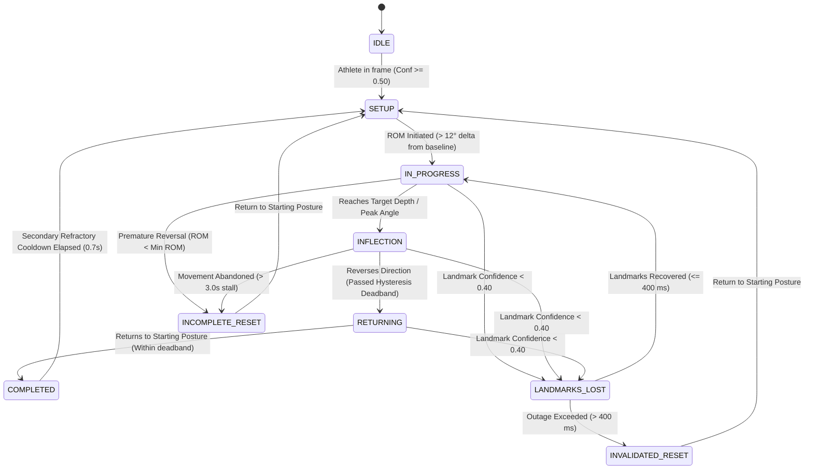

# PHASE 9B — AI FORM ANALYSIS: EXERCISE INTELLIGENCE & REAL-TIME ARCHITECTURE
## Comprehensive Architectural Specification & Implementation Plan (Revised)

**Version:** 1.1.0 (REVISED)  
**Status:** REVISED DRAFT — AWAITING USER APPROVAL  
**Author:** AI Pair Programmer (DeepMind Antigravity)  
**Target Milestone:** Phase 9B — Exercise Intelligence, Rep Counting, Form Heuristics, Scoring & Real-Time Engine  
**System Boundary:** Exercise-Specific State Machines, Biomechanical Technique Heuristics, Deterministic Scoring, In-Memory Session Management, Real-Time WebSocket Streaming, Frontend Camera Integration, Deterministic Tests  

---

## 1. Executive Summary & Core Architectural Decisions

Phase 9A established the foundational computer vision infrastructure: MediaPipe Tasks 33-landmark extraction, geometric vector math, 2D/3D joint angle calculators, deterministic confidence aggregation, and stateless frame endpoints.

**Phase 9B** transforms this static geometric foundation into **active exercise intelligence**. It introduces:
1. **Deterministic Rep-Counting State Machines:** Biomechanically bounded Finite State Machines (FSMs) for 5 core exercises with hysteresis, minimum range of motion, secondary refractory cooldown, and strict 400 ms landmark-loss handling.
2. **Deterministic Form Heuristics:** Objective visual geometry rules evaluating exercise depth, joint alignment, bilateral symmetry, stability, and tempo.
3. **Transparent Form Scoring Model:** A mathematically normalized 0–100 scoring system with explicit component weights, confidence dampening, and an explicit `INSUFFICIENT_DATA` state.
4. **Structured Deterministic Feedback:** Machine-readable feedback items delivering actionable biomechanical coaching cues without LLM hallucination.
5. **Real-Time Streaming Engine:** High-performance WebSocket frame analysis pipeline with bounded client-side latest-frame-wins backpressure (targeting 15–18 analysis FPS).
6. **Configurable In-Memory Session Management:** Ephemeral, user-isolated session state with configurable limits, TTL cleanup, and zero database persistence.
7. **Frontend Camera & Skeleton Overlay Integration:** Extends the existing approved `/form-analysis` UI with live webcam access, real-time skeleton overlay, live rep counts, tracking status indicators, and active form feedback cards.

### Compute Distribution Architecture (Where Components Run):
```
+-----------------------------------------------------------------------------------------+
|                                    CLIENT (BROWSER)                                     |
|  - Camera Capture (getUserMedia)                                                        |
|  - Frame Downscale & WebP Encode (640x480, quality 0.65)                                |
|  - Bounded Latest-Frame-Wins Queue (depth 1-2)                                          |
|  - WebSocket Client Transport (Binary frame + JSON control)                             |
|  - Canvas 2D Skeleton Overlay & UI Render (No ML runs in browser)                       |
+--------------------------------------------+--------------------------------------------+
                                             | WebSocket (Binary frames / JSON telemetry)
                                             v
+-----------------------------------------------------------------------------------------+
|                                  SERVER (FASTAPI BACKEND)                               |
|  - WebSocket Endpoint (/api/v1/form-analysis/ws/stream/{session_id})                    |
|  - Firebase Token Auth & Cross-User Session Isolation                                   |
|  - OpenCV Frame Decode (in-memory bytes -> BGR numpy array)                             |
|  - MediaPipe Tasks Vision PoseLandmarker (Local CPU/GPU inference)                      |
|  - Geometry Utilities (Phase 9A 2D/3D joint angles & landmark centroids)                |
|  - Exercise-Specific FSMs (Rep counting, phase progression, 400ms occlusion tolerance)   |
|  - Form Technique Heuristics (Depth, flare, valgus proxy, symmetry, torso lean)        |
|  - Form Scoring Engine (0-100 or INSUFFICIENT_DATA, confidence dampening)               |
|  - Ephemeral Session Store (In-memory bounded dict, 15-min TTL, zero DB persistence)    |
+-----------------------------------------------------------------------------------------+
```

### Core Guardrails & Boundary Invariants:
- **Visual Technique Heuristics, NOT Medical Diagnosis:** All assessments are observational visual form heuristics for technique coaching. They are strictly NOT clinical diagnoses, NOT injury risk predictions, and make NO claims or guarantees of injury prevention.
- **Observational Terminology Only:** Movement is never classified as "safe" or "unsafe". Heuristic evaluations use neutral technique language (e.g., *"Knee tracking appears inconsistent with the configured technique threshold"*).
- **Clear Separation of "Bad Form" vs. "Insufficient Data":** Missing or occluded landmarks are classified as `NOT_OBSERVABLE` or `INSUFFICIENT_CONFIDENCE`. They are **never** penalized as form defects.
- **Target Latency, Not Guaranteed Latency:** Target p95 end-to-end analysis latency is $\le 150\text{ ms}$ on the reference development machine, with 40–70 ms retained strictly as a stretch target under favorable local conditions. Latency is measured empirically across the complete pipeline.
- **Estimated Body Center, NOT Center of Mass:** Landmark centroids are defined as "estimated body center" approximations. They are not authoritative biomechanical center-of-mass calculations.
- **Barbell Trajectory Deferred:** MediaPipe PoseLandmarker tracks human anatomical landmarks only. No barbell detection model is included in Phase 9B. Barbell trajectory tracking is deferred to a future phase.
- **Zero Cloud CV / Zero Paid APIs:** Operates 100% locally on CPU without external credentials or cloud provider dependencies.
- **Zero Raw Video / Frame Persistence:** Camera frames exist only in volatile RAM during decoding and are immediately discarded. No video files or raw frames are saved to disk, database, or logs.
- **Zero Firestore Persistence:** Form analysis sessions are strictly ephemeral in-memory state. No Firestore writes occur for live frames or session telemetry.
- **Strict Phase 9C Boundary:** Multi-set persistence, historical analytics, audio/speech coaching, and video clip uploads remain deferred to Phase 9C.
- **Phase 1–8 & 9A Code Frozen:** Zero modifications to existing business logic or database schemas from earlier approved milestones.

---

## 2. Supported Exercise Catalog & Biomechanical Specifications

Phase 9B focuses on a limited, high-quality initial set of 5 foundational multi-joint and isolation exercises:

| Exercise | Movement Pattern | Primary Evaluated Joints | Recommended View | Key Technique Indicators |
|---|---|---|---|---|
| **Squat** | Knee & Hip Flexion / Extension | Left/Right Knee, Hip, Torso, Ankle, Heel | Side (Sagittal) or 3/4 Oblique | Depth threshold, knee tracking proxy, torso inclination, heel stability |
| **Bench Press** | Horizontal Upper-Body Push | Left/Right Elbow, Shoulder, Wrist, Torso | 45° Oblique or Side Profile | Elbow flexion depth, elbow flare angle, wrist-over-elbow stacking |
| **Deadlift** | Hip Hinge & Knee Extension | Left/Right Hip, Knee, Ankle, Shoulder, Spine | Side Profile (Sagittal) | Hip/knee sequencing, torso inclination, spine alignment proxy, body center |
| **Bicep Curl** | Single-Joint Elbow Flexion | Left/Right Elbow, Shoulder, Wrist, Torso | Side Profile or Frontal | Elbow pinning/drift, full ROM, torso momentum proxy |
| **Shoulder Press** | Vertical Upper-Body Push | Left/Right Elbow, Shoulder, Wrist, Torso | Frontal or 45° Oblique | Overhead lockout, forearm verticality, lumbar arch/torso lean proxy |

---

## 3. Camera Guidance and Observability Specification

Different exercises and visual heuristics require specific camera perspectives. The system must enforce observability prerequisites before computing heuristics, rather than assuming all metrics are valid from any view.

| Exercise | Recommended View | Camera Distance & Height | Required Keypoints | Optional Keypoints | Observable Heuristics from this View | Non-Observable Heuristics |
|---|---|---|---|---|---|---|
| **Squat** | Side Profile (Sagittal) or 3/4 Oblique | 2.5–3.5 m, waist height (0.9–1.1 m) | Hip, Knee, Ankle, Shoulder on camera-facing side | Heel, Toe, Contralateral joints | Depth (Knee flexion), Torso inclination, Heel stability (if foot visible) | Knee valgus requires frontal/oblique view; sagittal cannot evaluate lateral knee cave |
| **Bench Press** | 45° Oblique (toward head/shoulder) | 2.0–2.5 m, bench height (0.8–1.0 m) | Shoulder, Elbow, Wrist (primary side or bilateral) | Hip, Knee | Elbow flexion depth, Elbow flare angle, Wrist-over-elbow vertical stacking | Direct sagittal view occludes contralateral arm and obscures flare angle |
| **Deadlift** | Side Profile (Sagittal) | 2.5–3.5 m, mid-shin height (0.5–0.7 m) | Shoulder, Hip, Knee, Ankle on camera-facing side | Ear (neck alignment), Wrist | Hip/knee sequencing, Torso inclination, Spine alignment proxy, Body-center trajectory | Bilateral knee symmetry cannot be observed from pure side view |
| **Bicep Curl** | Side Profile (for drift) or Frontal (for symmetry) | 2.0–2.5 m, chest height (1.2–1.4 m) | Shoulder, Elbow, Wrist on active arm | Hip, Torso | Elbow flexion ROM, Elbow pinning / anterior drift, Torso momentum | Frontal view cannot measure anterior elbow drift |
| **Shoulder Press** | Frontal or 45° Oblique | 2.5–3.0 m, chest height (1.2–1.4 m) | Left & Right Shoulder, Elbow, Wrist, Hip | Ears, Ankles | Overhead lockout, Forearm verticality, Bilateral press symmetry, Lumbar arch | Pure side view occludes contralateral arm |

### Minimum Observability Invariant:
- If a heuristic requires landmarks that are not visible or have confidence below the minimum threshold ($c < 0.50$), the heuristic state MUST be set to `NOT_OBSERVABLE` or `INSUFFICIENT_CONFIDENCE`.
- The system must **never** infer a technique fault from a missing landmark.

---

## 4. Rep-Counting State Machines (Deterministic FSM)

Repetition counting is managed by an exercise-specific **Deterministic Finite State Machine (FSM)**. Timers are NEVER used as a proxy for movement.



### FSM State Definitions:
1. `IDLE`: No athlete detected or tracking confidence below setup threshold.
2. `SETUP`: Athlete in frame, standing/holding starting posture with stable baseline joint angles for $\ge 300\text{ ms}$.
3. `IN_PROGRESS`: Primary joint angle deviates by $> 12^\circ$ from baseline in the eccentric/concentric direction.
4. `INFLECTION`: Primary joint reaches maximum excursion (e.g. bottom of squat, chest touch of bench, top of curl).
5. `RETURNING`: Movement reverses direction and clears the directional hysteresis deadband ($\pm 8^\circ\text{--}12^\circ$).
6. `COMPLETED`: Primary joint returns within $10^\circ$ of starting baseline posture with full ROM satisfied.
7. `INCOMPLETE_RESET`: Movement reversed before reaching minimum ROM or inflection threshold. Rep count does NOT increment.
8. `INVALIDATED_RESET`: Required landmarks were lost for $> 400\text{ ms}$ during active movement. Rep trajectory is purged. Rep count does NOT increment.

### State Machine Formal Rules:
1. **Transition Hysteresis:** A deadband of $\pm 8^\circ\text{--}12^\circ$ prevents rapid boundary oscillation between states.
2. **Minimum Range of Motion ($\text{ROM}_{\min}$):**
   - Squat: $\ge 60^\circ$ knee flexion delta.
   - Bench Press: $\ge 55^\circ$ elbow flexion delta.
   - Deadlift: $\ge 65^\circ$ hip extension delta.
   - Bicep Curl: $\ge 80^\circ$ elbow flexion delta.
   - Shoulder Press: $\ge 70^\circ$ elbow extension delta.
3. **Strict 400 ms Landmark-Loss Handling:**
   - If required landmarks drop below confidence threshold ($< 0.40$) during `IN_PROGRESS`, `INFLECTION`, or `RETURNING`:
     - Retain last valid kinematic state for at most **400 ms**.
     - Do NOT advance FSM state during this window.
     - If landmarks recover within 400 ms, resume active trajectory.
     - If tracking is not restored within 400 ms, transition immediately to `INVALIDATED_RESET`.
     - An invalidated trajectory **never** increments the rep counter.
4. **Secondary Refractory Cooldown (0.7 s):**
   - **The refractory cooldown is a secondary debounce mechanism, NOT the primary rep-counting criterion.**
   - Primary completion depends strictly on valid directional state progression, minimum ROM, reaching the inflection phase, returning to the starting boundary, and maintaining sufficient landmark confidence.
   - The cooldown exists solely to prevent duplicate counts from noisy micro-oscillations at the completion boundary. Fast legitimate movements with valid ROM are not rejected.
5. **Movement Trajectory Classification:**
   - The FSM explicitly categorizes every rep attempt into one of four deterministic outcomes:
     - `VALID_REP`: Full ROM, correct phase progression, rep counter increments by 1.
     - `INCOMPLETE_REP`: Movement reversed prematurely before inflection or minimum ROM. Emits informational event; rep counter does not increment.
     - `INVALIDATED_REP`: Landmarks lost $> 400\text{ ms}$ during movement. Trajectory discarded; rep counter does not increment.
     - `INSUFFICIENT_CONFIDENCE_REP`: Average landmark confidence below threshold ($< 0.50$). Rep counter does not increment.
6. **Tempo Definition & Kinematic-First Principle:**
   - Tempo is derived strictly from timestamps associated with **valid observed kinematic events**:
     - $\Delta t_{\text{eccentric}} = t_{\text{inflection}} - t_{\text{start}}$
     - $\Delta t_{\text{concentric}} = t_{\text{completed}} - t_{\text{inflection}}$
     - $\Delta t_{\text{pause}} = \text{duration at peak inflection}$
   - **Tempo must NEVER be used to infer a repetition when kinematic movement was not observed.**
   - "Time elapsed $\rightarrow$ automatically count rep" is strictly prohibited. The system is 100% kinematic-first.

---

## 5. Deterministic Form Heuristics (Visual Technique Evaluation)

All heuristics are observational technique rules evaluated at specific movement phases. They produce structured evaluations grounded entirely in measured joint angles and coordinates.

### 5.1 Squat Heuristics
1. **Depth Score ($H_{\text{depth}}$):**
   - Evaluated at `INFLECTION`. Knee flexion angle $\theta_{\text{knee}}$:
     - $\theta_{\text{knee}} \le 90^\circ$: Optimal depth (at or below parallel).
     - $91^\circ < \theta_{\text{knee}} \le 100^\circ$: Parallel depth.
     - $\theta_{\text{knee}} > 100^\circ$: Technique note: *"Squat depth did not reach the configured parallel threshold. Try increasing knee and hip flexion before returning."*
2. **Knee Tracking Proxy ($H_{\text{tracking}}$):**
   - Observable only when camera is front/oblique: Ratio $R = \frac{|x_{\text{LKnee}} - x_{\text{RKnee}}|}{|x_{\text{LAnkle}} - x_{\text{RAnkle}}|}$.
   - If $R < 0.75$ during ascent: Technique note: *"Knee tracking appears narrower than ankle width. Focus on pushing knees outward over toes."*
   - If view is pure sagittal: State = `NOT_OBSERVABLE`.
3. **Torso Forward Inclination ($H_{\text{torso}}$):**
   - Angle between Shoulder-Hip vector and vertical axis: $\alpha_{\text{torso}}$.
   - $\alpha_{\text{torso}} \le 35^\circ$: Upright/optimal.
   - $\alpha_{\text{torso}} > 50^\circ$: Technique note: *"Torso forward inclination exceeds 50°. Focus on keeping chest elevated throughout descent."*
4. **Heel Stability ($H_{\text{heel}}$):**
   - Observable only if feet are in frame ($c_{\text{heel}} \ge 0.50$): Vertical displacement $\Delta y = |y_{\text{heel}} - y_{\text{toe}}|$.
   - If foot is outside frame: State = `NOT_OBSERVABLE`. No penalty applied.
5. **Bilateral Symmetry ($H_{\text{symm}}$):**
   - $|\theta_{\text{LKnee}} - \theta_{\text{RKnee}}| > 12^\circ$: Technique note: *"Observed asymmetrical knee flexion between left and right sides."*

### 5.2 Bench Press Heuristics
1. **Elbow Flare Angle ($H_{\text{flare}}$):**
   - Angle between upper arm (Elbow-Shoulder) and torso (Shoulder-Hip):
     - $45^\circ\text{--}70^\circ$: Optimal tuck.
     - $> 78^\circ$: Technique note: *"Elbow flare exceeds 78°. Consider tucking elbows closer to 45°–60° for balanced shoulder mechanics."*
     - $< 35^\circ$: Technique note: *"Elbows appear over-tucked close to the torso."*
2. **Pressing Depth ($H_{\text{depth}}$):**
   - Elbow angle at inflection $\le 90^\circ$: Confirms full range to chest level.
3. **Wrist-over-Elbow Stacking ($H_{\text{stack}}$):**
   - Horizontal deviation $|x_{\text{wrist}} - x_{\text{elbow}}| / \text{ForearmLength} > 0.25$: Technique note: *"Wrists appear unstacked relative to elbows at bottom of press."*

### 5.3 Deadlift Heuristics (Barbell Detection Deferred)
*Note: Actual barbell trajectory tracking is deferred to a future phase when an object-detection model is introduced. Phase 9B evaluates body-motion technique proxies only.*
1. **Hip/Knee Sequencing ($H_{\text{sequence}}$):**
   - During first pull (`SETUP` $\rightarrow$ knee height): If $\Delta \theta_{\text{hip}} > 20^\circ$ while $\Delta \theta_{\text{knee}} < 5^\circ$:
     Technique note: *"Hips appear to be rising earlier than knees. Coordinate hip and knee extension simultaneously."*
2. **Torso Inclination ($H_{\text{torso}}$):**
   - Torso angle relative to horizontal at setup: $30^\circ\text{--}45^\circ$ optimal. Excessive vertical or horizontal starting posture flagged as technique note.
3. **Spine Alignment Proxy ($H_{\text{spine}}$):**
   - Collinearity deviation across Ear-Shoulder-Hip landmarks $> 15^\circ$: Technique note: *"Spine alignment deviation observed during pull. Focus on maintaining a neutral back."*
4. **Estimated Body-Center Trajectory ($H_{\text{body\_center}}$):**
   - Horizontal displacement of the landmark centroid during pull: $\Delta x_{\text{centroid}} > 0.08$ normalized units flags technique note: *"Estimated body center shifted horizontally during pull."*
   - *Explicit disclaimer: Landmark centroid is an estimated geometric proxy, NOT an authoritative biomechanical center-of-mass calculation.*

### 5.4 Bicep Curl Heuristics
1. **Elbow Pinning / Anterior Drift ($H_{\text{elbow\_pin}}$):**
   - Displacement of elbow vertex relative to shoulder vertical axis $> 0.08$ normalized units: Technique note: *"Elbows drifting forward during curl. Keep upper arms pinned by your sides."*
2. **Range of Motion ($H_{\text{rom}}$):**
   - Peak flexion $\le 50^\circ$; full extension $\ge 150^\circ$. Partial reps flagged with specific angular deficit.
3. **Torso Momentum Proxy ($H_{\text{momentum}}$):**
   - Backward torso tilt $> 12^\circ$ during concentric curl: Technique note: *"Torso backward lean observed during curl. Minimize body sway to isolate the biceps."*

### 5.5 Shoulder Press Heuristics
1. **Overhead Lockout ($H_{\text{lockout}}$):**
   - Elbow extension $\ge 165^\circ$ at top of press: Full lockout confirmed.
2. **Forearm Verticality ($H_{\text{vertical}}$):**
   - Angle between Forearm (Wrist-Elbow) and vertical $> 12^\circ$: Technique note: *"Forearms deviate from vertical. Keep wrists stacked directly over elbows."*
3. **Lumbar Arch / Torso Hyperextension Proxy ($H_{\text{arch}}$):**
   - Torso angle backward lean $> 18^\circ$ during overhead press: Technique note: *"Torso backward lean exceeds 18°. Engage core to prevent excessive lumbar arching."*

---

## 6. Form Scoring Model (Deterministic & Observable)

Form scoring computes a deterministic score $S(r) \in [0, 100]$ per completed repetition, or explicitly marks the repetition as `INSUFFICIENT_DATA`.

### 6.1 Scoring Category Weights (Standardized Terminology)
The scoring categories and weights are strictly defined as:

| Category | Weight ($w_i$) | Rationale |
|---|---|---|
| **Range of Motion / Depth** | **0.40** | Full range of motion is the foundational criterion of repetition validity across all strength exercises. |
| **Joint Alignment / Technique** | **0.35** | High-leverage joint alignment (elbow flare, knee tracking proxy, spine posture) directly reflects proper lifting mechanics. |
| **Bilateral Symmetry** | **0.15** | Evaluates balanced load distribution and equal bilateral limb contribution. |
| **Stability / Tempo** | **0.10** | Controlled eccentric/concentric cadence and lack of erratic momentum reflect muscular control. |

$$\sum_{i=1}^{4} w_i = 0.40 + 0.35 + 0.15 + 0.10 = 1.00$$

### 6.2 Observability Threshold & `INSUFFICIENT_DATA` State
Before calculating a numerical score, the system checks whether required observations meet the **Observability Threshold**:
- **Rule:** For each exercise, at least **70% of the weighted heuristics** must have an observation state of `OBSERVED` with mean landmark confidence $\ge 0.50$.
- If observable coverage $< 70\%$:
  - **Score Status:** `INSUFFICIENT_DATA`
  - **Numerical Score:** `null` (None)
  - **Score Badge:** *"Insufficient Data — Adjust Camera"*
  - **Explanation:** The feedback object explicitly lists which required landmarks were occluded or out of frame.
  - **Zero Misleading Precision:** Low-observation attempts **never** receive a fabricated numerical score.

### 6.3 Repetition Scoring Formula (When Observable)
When observability criteria are satisfied:
$$S(r) = \max\left(0, 100 - \sum_{i=1}^{k} \left( P_i \times w_i \right) \right) \times C_{\text{penalty}}$$

Where:
- $P_i \in [0, 100]$: Penalty magnitude for heuristic $i$, proportional to deviation beyond configured acceptable deadband.
- $w_i$: Category weight normalized across observable categories.
- $C_{\text{penalty}} \in [0.60, 1.0]$: Confidence dampening factor applied **only after** observability is confirmed:
  $$C_{\text{penalty}} = \max(0.60, \min(1.0, \bar{c}_{\text{rep}}))$$
  where $\bar{c}_{\text{rep}}$ is the mean tracking confidence of evaluated keypoints during the rep.
- Score is mathematically clamped to $[0, 100]$.

---

## 7. Structured Feedback Contract

All feedback is deterministic, strongly typed, and grounded in measured CV outputs:

```typescript
export type ObservationState = 'OBSERVED' | 'INSUFFICIENT_CONFIDENCE' | 'NOT_OBSERVABLE' | 'INVALID';

export interface FormFeedbackItem {
  type: 'positive' | 'improvement' | 'warning' | 'insufficient_data';
  severity: 'low' | 'medium' | 'high' | 'none';
  metric: string;               // e.g. "squat_depth", "elbow_flare", "spine_alignment"
  observation_state: ObservationState;
  observed_value: number | null; // e.g. 102.5 degrees, or null if unobserved
  expected_range: [number, number] | null; // e.g. [70.0, 95.0]
  unit: string;                 // "degrees", "ratio", "norm_units"
  message: string;              // Deterministic coaching cue
  confidence: number;           // 0.0 to 1.0
  rep_number: number;
  timestamp_ms: number;
}
```

### Deterministic Feedback Generation Rules:
- **No LLM Generation:** Feedback text is assembled from deterministic templates parameterized by observed values and configured thresholds.
- **No Physiological Extrapolations:** Messages never make unmeasurable claims (e.g. *"Descend 3–4 inches deeper for full quad engagement"* is prohibited). Instead: *"Squat depth was 104°, above the 95° parallel threshold. Increase knee and hip flexion before returning."*
- **Insufficient Data Messages:** If keypoints are missing: *"Heel position could not be observed from the current camera view. Ensure your entire feet are visible."*

---

## 8. Real-Time Streaming Architecture & Measured Performance Targets

### 8.1 Performance Targets (Development Reference Machine)
- **Target p95 End-to-End Analysis Latency:** $\le 150\text{ ms}$ on the reference development machine.
- **Stretch Target:** 40–70 ms retained only under favorable local conditions (dedicated GPU/CPU acceleration, low frame resolution).
- **Latency is Measured, NOT Claimed:** Every frame carries a client timestamp $t_{\text{client\_sent}}$. Server appends $t_{\text{server\_received}}$ and $t_{\text{server\_processed}}$. Client computes round-trip latency upon receiving analysis:
  $$\text{Latency}_{\text{E2E}} = t_{\text{client\_received}} - t_{\text{client\_sent}}$$

### Measured Latency Path:
```
[Camera Capture]
       │
       ▼
[WebP Frame Encode (Client)]
       │
       ▼
[WebSocket Binary Transmission]
       │
       ▼
[Server Binary Decode (OpenCV)]
       │
       ▼
[MediaPipe PoseLandmarker Inference]
       │
       ▼
[Geometry Angles & Landmark Centroid]
       │
       ▼
[Exercise-Specific FSM Evaluation]
       │
       ▼
[Heuristic Evaluation & Scoring]
       │
       ▼
[JSON Response Serialization]
       │
       ▼
[WebSocket Transmission]
       │
       ▼
[Browser JSON Parse & Canvas Overlay Render]
```

### Telemetry Metrics Tracked per Session:
- `p50_latency_ms`: Median end-to-end latency over the last 100 frames.
- `p95_latency_ms`: 95th percentile latency.
- `server_processing_time_ms`: Time spent in OpenCV decode + MediaPipe + FSM + scoring.
- `pose_inference_time_ms`: Time spent strictly in MediaPipe `PoseLandmarker.detect()`.
- `effective_analysis_fps`: Number of analyzed frames per second delivered to client.
- `dropped_frames_client`: Frames dropped on the client due to latest-frame-wins backpressure.
- `active_session_count`: Current concurrent sessions on the server.

---

## 9. WebSocket Protocol Specification

Communication between browser and backend uses a full-duplex WebSocket connection mounted at:  
`/api/v1/form-analysis/ws/stream/{session_id}`

### 9.1 Client $\rightarrow$ Server Messages

1. **`frame` (Binary Message):**
   - Binary layout: First 32 bytes contain a fixed binary header; remaining bytes contain the raw WebP/JPEG image payload.
   ```
   [0..15]   UUID session_id (16 bytes binary)
   [16..23]  uint64 sequence_number (8 bytes, big-endian)
   [24..31]  uint64 timestamp_ms (8 bytes, big-endian)
   [32..End] Binary image bytes (WebP / JPEG)
   ```
2. **`pause` (JSON Text Message):**
   `{"type": "pause", "session_id": "...", "timestamp_ms": 123456}`
3. **`resume` (JSON Text Message):**
   `{"type": "resume", "session_id": "...", "timestamp_ms": 123456}`
4. **`stop` (JSON Text Message):**
   `{"type": "stop", "session_id": "...", "timestamp_ms": 123456}`
5. **`ping` (JSON Text Message):**
   `{"type": "ping", "sequence": 42, "timestamp_ms": 123456}`

### 9.2 Server $\rightarrow$ Client Messages (JSON Text)

1. **`ack`:** Confirms frame receipt and processing latency.
   `{"type": "ack", "sequence_number": 42, "server_time_ms": 123480, "processing_ms": 18}`
2. **`analysis`:** Per-frame posture telemetry.
   ```json
   {
     "type": "analysis",
     "sequence_number": 42,
     "timestamp_ms": 123456,
     "latency_e2e_ms": 45.2,
     "tracking_status": "TRACKING_ACTIVE",
     "fsm_state": "IN_PROGRESS",
     "primary_angle": 112.4,
     "rep_count": 3,
     "landmarks": [{"id": 0, "x": 0.51, "y": 0.22, "z": -0.12, "visibility": 0.98}],
     "joint_angles": {"left_knee": 112.4, "right_knee": 110.8, "torso_lean": 24.1}
   }
   ```
3. **`rep_completed`:** Emitted when an FSM reaches `COMPLETED`.
   ```json
   {
     "type": "rep_completed",
     "rep_number": 4,
     "score": 88,
     "score_status": "SCORED",
     "fsm_outcome": "VALID_REP",
     "rom_degrees": 72.4,
     "duration_ms": 2350,
     "feedback_items": [...]
   }
   ```
4. **`feedback`:** Real-time corrective cues.
5. **`tracking_status`:** Emitted on state changes (`SETUP`, `LANDMARKS_LOST`, `OCCLUDED`).
6. **`session_state`:** Current aggregate session summary.
7. **`error`:** Protocol errors, size violations, authentication failures.
8. **`pong`:** Keepalive response.

### 9.3 Protocol Anomaly Handling:
- **Dropped / Stale Frames:** If a received frame has `sequence_number <= last_processed_sequence`, it is dropped immediately.
- **Out-of-Order Frames:** Server processes latest sequence number; older frames are discarded.
- **Malformed Payloads:** Triggers `error` message and closes connection with code 1008 (Policy Violation) if repeated.

---

## 10. Client-Side Backpressure & Frame Sampling

Processing every 60 FPS camera frame on CPU causes buffer bloat and lag. The client enforces **bounded latest-frame-wins backpressure**.

```
[Camera Video Stream (30-60 FPS)]
              │
              ▼
[HTML5 Canvas Capture & Downscale (640x480)]
              │
              ▼
[Bounded Queue (Capacity: 1 Frame)]
   - If slot is empty: Store new frame
   - If slot is full: Overwrite with newest frame (Old frame discarded)
              │
              ▼
[WebSocket Dispatcher (Target 15-18 FPS)]
   - Reads newest frame from queue at ~60ms intervals
   - Emits frame over WebSocket
              │
              ▼
[Zero Stale Backlog Invariant]
```

### Rate Distinctions:
- **Camera Capture Rate:** Native camera feed (30–60 FPS).
- **Encoded Frame Rate:** Client encoding loop (15–18 FPS, 60 ms interval).
- **Sent FPS:** Frames transmitted over WebSocket.
- **Processed FPS:** Frames successfully analyzed by server.
- **Rendered Result FPS:** UI skeleton overlay updates (~15–18 FPS).

---

## 11. Configurable Operational Limits & Ephemeral Session Store

All operational limits are externalized into environment variables and application settings:

| Setting Key | Default Value | Description |
|---|---|---|
| `FORM_MAX_CONCURRENT_SESSIONS` | `50` | Maximum simultaneous active sessions across all users. |
| `FORM_SESSION_TTL_SECONDS` | `900` (15 min) | Inactivity timeout before an idle session is evicted from RAM. |
| `FORM_MAX_FRAME_BYTES` | `5242880` (5 MB) | Maximum permitted raw frame payload size. |
| `FORM_MAX_FRAME_WIDTH` | `1920` | Maximum decoded image width. |
| `FORM_MAX_FRAME_HEIGHT` | `1080` | Maximum decoded image height. |
| `FORM_MAX_ACCEPTED_FPS` | `25` | Server-side rate limiter threshold per connection. |
| `FORM_MAX_SESSION_DURATION_SECONDS` | `3600` (1 hour) | Hard limit on session duration before forced closure. |
| `FORM_IDLE_TIMEOUT_SECONDS` | `300` (5 min) | WebSocket idle disconnect if no frames received. |
| `FORM_MAX_WS_MESSAGE_BYTES` | `5500000` | Maximum WebSocket incoming message buffer. |

### Session Record Structure (In-Memory Only):
```python
class FormAnalysisSession:
    session_id: str                   # UUID4
    user_id: str                      # Firebase UID
    exercise_id: str                  # e.g. "ex_squat"
    fsm: ExerciseFSM                  # Deterministic state machine instance
    rep_count: int                    # Completed valid reps
    completed_reps: List[RepTelemetry]# Bounded to last 50 reps
    recent_joint_history: Deque       # Rolling 60 frames (~3.5s)
    recent_feedback: Deque            # Rolling 10 feedback items
    aggregate_score: Optional[float]  # Rolling mean score
    created_at: float                 # Epoch timestamp
    last_activity_at: float           # Epoch timestamp
```
- **Zero Database Persistence:** Sessions exist exclusively in RAM. When a session ends or times out, memory is freed.

---

## 12. Security, Privacy & Resource Protection

1. **Authentication Prior to Processing:**
   - WebSocket connection handshake requires a valid Firebase ID token (via `Authorization: Bearer <token>` query param or header).
   - Unauthenticated or expired tokens are rejected with WebSocket close code `1008 (Policy Violation)`.
2. **Cross-User Session Isolation:**
   - `session.user_id` is strictly bound to the authenticated `current_user.uid`.
   - Accessing another user's session returns an authorization error.
3. **Resource & DoS Protections:**
   - Frame payloads exceeding `FORM_MAX_FRAME_BYTES` (5 MB) are rejected before full decoding.
   - Max 25 frames/second per connection enforced via token bucket rate limiter.
   - Global session ceiling (`FORM_MAX_CONCURRENT_SESSIONS=50`) prevents memory exhaustion.
4. **Zero Raw Video / Frame Persistence Guarantee:**
   - Decoded frame bytes are stored in temporary in-memory NumPy buffers during inference.
   - Zero `open(..., 'wb')`, zero temporary disk caching, zero S3/Firebase Storage uploads, and zero raw frame logging.
5. **Zero Cloud CV Provider:**
   - MediaPipe Tasks Vision runs 100% locally on the backend server. Zero telemetry or images are sent to external APIs.

---

## 13. Frontend UI Integration Plan

The approved UI in `src/pages/app/FormAnalysisPage.tsx` and its child components will be preserved and connected to the real-time engine without altering visual layout or styling.

```
+-----------------------------------------------------------------------------------+
|  [FormAnalysisHeader]  Exercise: [ Squat v ]   Status: [ TRACKING ACTIVE ]        |
+-----------------------------------------------------------------------------------+
|  [ExerciseAnalysisSummary] Reps: 8 | Score: 88 | Status: Optimal | Conf: 92%      |
+-------------------------------------------------+---------------------------------+
|  LEFT COLUMN (8 of 12 cols):                   | RIGHT COLUMN (4 of 12 cols):    |
|                                                 |                                 |
|  [FormAnalysisViewport]                         | [RealtimeStatusCard]            |
|  +-------------------------------------------+  | Waveform, FPS & Measured Latency|
|  | <video> Live Webcam Stream                |  |                                 |
|  | <canvas> SVG Skeleton Landmark Overlay    |  | [FormScoreBreakdownCard]        |
|  | Floating Cards: [Knee 88°] [Torso 28°]    |  | Depth: 92% | Alignment: 85%     |
|  | Camera Controls: [Start / Pause / Stop]   |  |                                 |
|  | Camera Guidance Alert (if occluded)       |  | [MuscleActivationCard]          |
|  +-------------------------------------------+  | Targeted Muscle Engagement      |
|                                                 |                                 |
|  [KeyMetricsGrid]                               | [AICoachingTipsCard]            |
|  Depth Score | Valgus Proxy | Torso | Tempo     | Deterministic Technique Cues    |
|                                                 |                                 |
|  [AICoachFeedbackCard]     [RepProgressCard]    | [AnalysisHistoryCard]           |
|  Live Structured Feedback  Rep 1..8 Badges      | Current Session Rep Telemetry   |
+-------------------------------------------------+---------------------------------+
```

### Component Extensions:
1. `FormAnalysisViewport.tsx`: Embeds `<video>` (hidden or background) and overlay `<canvas>` drawing skeleton bones with color-coded technique states (green = optimal, amber = technique note, red = out of bounds).
2. `ExerciseAnalysisSummary.tsx`: Binds rep counter, live score (or "INSUFFICIENT DATA"), and tracking status pill to WebSocket state events.
3. `FormScoreBreakdownCard.tsx`: Displays real-time breakdown across ROM/Depth, Joint Alignment/Technique, Bilateral Symmetry, and Stability/Tempo.
4. `AICoachFeedbackCard.tsx`: Lists incoming deterministic feedback cues.

---

## 14. Comprehensive Deterministic Test Strategy

### Core Deterministic Invariant:
> **"Identical input trajectory + identical configuration MUST produce identical rep count, score, and feedback."**

### Test Coverage Matrix (For ALL 5 Supported Exercises):

| Test Scenario | Input Trajectory | Expected FSM State | Expected Rep Count | Expected Score Status |
|---|---|---|---|---|
| **Valid Full Rep** | Clean sinusoidal angle curve exceeding ROM | `IDLE` $\rightarrow$ `SETUP` $\rightarrow$ `IN_PROGRESS` $\rightarrow$ `INFLECTION` $\rightarrow$ `RETURNING` $\rightarrow$ `COMPLETED` | Increments by 1 | `SCORED` (85–100) |
| **Partial Rep (Insufficient ROM)** | Excursion reaches only 35° (below $\text{ROM}_{\min}$) | `IN_PROGRESS` $\rightarrow$ `INCOMPLETE_RESET` | **No change (0)** | N/A (Rep not counted) |
| **Premature Reversal** | Reverses halfway before inflection | `IN_PROGRESS` $\rightarrow$ `INCOMPLETE_RESET` | **No change (0)** | N/A |
| **Temporary Occlusion ($\le 400\text{ ms}$)** | Confidence drops to 0.0 for 300 ms, then recovers | Enters `LANDMARKS_LOST`, resumes `IN_PROGRESS` | Increments by 1 upon completion | `SCORED` (Dampened confidence) |
| **Extended Occlusion ($> 400\text{ ms}$)** | Confidence drops to 0.0 for 600 ms during rep | Enters `LANDMARKS_LOST`, transitions to `INVALIDATED_RESET` | **No change (0)** | N/A (Rep invalidated) |
| **Boundary Hysteresis** | Oscillates by $\pm 3^\circ$ around $90^\circ$ threshold | Deadband absorbs oscillation; zero premature state flips | Follows true trajectory | `SCORED` |
| **Duplicate Rep Suppression** | Fast secondary inflection signal within 200 ms | Cooldown suppresses duplicate completion event | Count increments by 1 only | `SCORED` |
| **Rapid Valid Movement** | Fast rep (0.8s total duration) with full ROM | Valid phase progression verified; completes successfully | Increments by 1 | `SCORED` |
| **Asymmetric Movement** | Bilateral joint angles differ by $> 15^\circ$ | Valid rep counted | Increments by 1 | `SCORED` (Symmetry deduction applied) |
| **Insufficient Camera Visibility** | Missing required joints ($c < 0.40$) throughout | Stays in `SETUP` or `IDLE` | **No change (0)** | `INSUFFICIENT_DATA` (null score) |
| **Dropped / Out-of-Order Frames** | Frames arrive with sequence numbers $[1, 2, 5, 3, 6]$ | Frame 3 dropped as stale; frames 5 and 6 processed | Resilient tracking | `SCORED` |

---

## 15. Explicit Phase Boundaries (Phase 9B vs. Phase 9C)

### Strictly Included in Phase 9B:
- Deterministic FSM state machines for Squat, Bench Press, Deadlift, Bicep Curl, Shoulder Press.
- Visual technique form heuristics and 0–100 scoring model with `INSUFFICIENT_DATA` support.
- Deterministic structured feedback generation (no LLM, no unmeasured claims).
- WebSocket streaming pipeline with client-side latest-frame-wins backpressure.
- Ephemeral in-memory session manager with configurable limits and TTL eviction.
- Frontend webcam capture, skeleton overlay canvas, and real-time UI data binding.
- Comprehensive unit, integration, and WebSocket test suite using synthetic landmark trajectories.

### Strictly Deferred to Phase 9C (PROHIBITED IN 9B):
- ❌ Persistent Cloud Firestore storage of form-analysis sessions or sets.
- ❌ Multi-set workout telemetry persistence.
- ❌ Historical analytics, weekly form improvement trends, or PR form badges.
- ❌ Web Audio sound effects or synthetic speech/voice coaching.
- ❌ Video recording, clip compression, or video upload to Firebase Storage.
- ❌ Post-workout AI Coach Gemini LLM narrative synthesis.
- ❌ Social sharing or recording exports.
- ❌ Barbell / weight plate object detection.

---

## 16. Exact File Plan

### 16.1 New Files to Create

| File Path | Component | Responsibility |
|---|---|---|
| `backend/app/services/exercise_fsm.py` | Exercise Intelligence | Deterministic FSM engine: phase progression, hysteresis deadband, minimum ROM, secondary refractory cooldown, and 400 ms occlusion recovery for all 5 exercises. |
| `backend/app/services/form_heuristics.py` | Technique Heuristics | Visual geometry rules (depth, flare, valgus proxy, spine alignment proxy, torso lean) and deterministic feedback generator. |
| `backend/app/services/form_scoring.py` | Form Scoring | Weighted normalization (ROM 0.40, Technique 0.35, Symmetry 0.15, Stability 0.10), observability threshold checking, `INSUFFICIENT_DATA` state, and confidence dampening. |
| `backend/app/services/form_session_manager.py` | Ephemeral State | Bounded in-memory session store, rolling telemetry buffers, TTL eviction task, and cross-user isolation. |
| `backend/tests/test_exercise_fsm.py` | Unit Tests | FSM transitions, complete reps, incomplete reps, hysteresis, rapid reps, and 400 ms occlusion tests across all 5 exercises. |
| `backend/tests/test_form_heuristics.py` | Unit Tests | Threshold verification, observability states, and deterministic feedback messages for all 5 exercises. |
| `backend/tests/test_form_scoring.py` | Unit Tests | Score bounds [0, 100], weight summation (= 1.00), observability threshold, `INSUFFICIENT_DATA` state, and confidence penalties. |
| `backend/tests/test_form_session_manager.py` | Unit Tests | Session lifecycle, configurable limits, cross-user tenant isolation, and TTL expiry. |
| `backend/tests/test_form_analysis_websocket.py` | Integration Tests | WebSocket handshake, Firebase auth, binary frame streaming, backpressure, and anomaly handling. |
| `src/services/formAnalysisStream.ts` | Frontend Service | WebSocket client managing camera frame extraction (WebP), bounded latest-frame-wins backpressure, and live event dispatching. |

### 16.2 Existing Files to Modify

| File Path | Target Section | Changes |
|---|---|---|
| `backend/app/core/config.py` | Configuration | Add configurable operational limits (`FORM_MAX_CONCURRENT_SESSIONS`, `FORM_SESSION_TTL_SECONDS`, `FORM_MAX_FRAME_BYTES`, etc.). |
| `backend/app/schemas/form_analysis.py` | Schemas | Add `ObservationState`, `FormFeedbackItemSchema`, `RepTelemetrySchema`, `LiveSessionStateResponse`, and WebSocket message schemas. |
| `backend/app/api/v1/endpoints/form_analysis.py` | Endpoints | Add WebSocket endpoint `/ws/stream/{session_id}` and session lifecycle routes (`/session/start`, `/session/stop`). |
| `src/types/index.ts` | Types | Export `LiveFormFeedback`, `RepTelemetry`, `StreamSessionState`, and `ObservationState` contracts. |
| `src/components/form-analysis/FormAnalysisViewport.tsx` | Component | Add live `<video>` feed, `<canvas>` 2D skeleton overlay, camera setup guidance, and session controls. |
| `src/pages/app/FormAnalysisPage.tsx` | Page | Wire real-time streaming service, exercise selector, and live telemetry cards. |

---

## 17. Objective Acceptance Criteria for Phase 9B

Phase 9B will be declared complete ONLY when all of the following criteria are met:

1. **Architecture & Transport:**
   - Full-duplex WebSocket communication operates reliably between browser and FastAPI.
   - Client enforces bounded latest-frame-wins backpressure with zero stale frame buildup.
   - MediaPipe Tasks Vision runs strictly on the backend server.
2. **Computer Vision & In-Memory Privacy:**
   - 100% local execution with zero cloud CV dependencies.
   - Raw video frames decoded in RAM and immediately discarded. Zero disk caching, zero frame logging, zero Firestore writes for live frames.
3. **Rep Counting State Machines:**
   - All 5 exercises (Squat, Bench Press, Deadlift, Bicep Curl, Shoulder Press) execute deterministic FSMs.
   - Valid reps count exactly once. Incomplete reps, aborted reps, and twitches do not increment count.
   - Temporary landmark loss $\le 400\text{ ms}$ preserves state; $> 400\text{ ms}$ invalidates trajectory.
   - Secondary refractory cooldown (0.7s) debounces noise without blocking rapid valid reps.
4. **Form Technique Heuristics & Scoring:**
   - Technique heuristics use neutral coaching language with zero medical or safety claims.
   - Missing landmarks trigger `NOT_OBSERVABLE` or `INSUFFICIENT_CONFIDENCE`, never a form penalty.
   - Observable coverage $< 70\%$ produces `INSUFFICIENT_DATA` with `null` score (no misleading scores).
   - Valid scores strictly bounded in $[0, 100]$ using documented weights (ROM 0.40, Technique 0.35, Symmetry 0.15, Stability 0.10).
5. **Measured Performance:**
   - Actual end-to-end latency measured and logged (target p95 $\le 150\text{ ms}$).
   - Processing FPS, p50/p95 latency, and dropped frames reported in telemetry.
6. **Frontend Integration & Visual Preservation:**
   - Existing approved `/form-analysis` visual layout preserved.
   - Webcam feed, canvas skeleton overlay, rep counter, score, and feedback cards update in real time.
7. **Security & Tenant Isolation:**
   - WebSocket requires valid Firebase authentication.
   - Strict cross-user isolation (`session.user_id == current_user.uid`).
   - Configurable limits enforced (session TTL, payload size, max sessions).
8. **Deterministic Test Suite:**
   - All new unit and integration tests pass 100%.
   - Full backend regression suite passes without regression.
   - Frontend production build (`npm run build`) succeeds with 0 TypeScript/Vite errors.
9. **Zero Phase 9C Leakage:**
   - No Firestore session persistence, no multi-set telemetry, no audio synthesis, no video uploads, no barbell detection model.

---

## 18. Conclusion

This revised plan incorporates all required architectural refinements, establishes rigorous boundaries between technique coaching and medical diagnosis, eliminates unmeasured latency guarantees, enforces clear separation between missing data and form defects, and provides a deterministic foundation for real-time exercise intelligence.

**STOP. Awaiting user review and explicit approval before modifying any code.**
