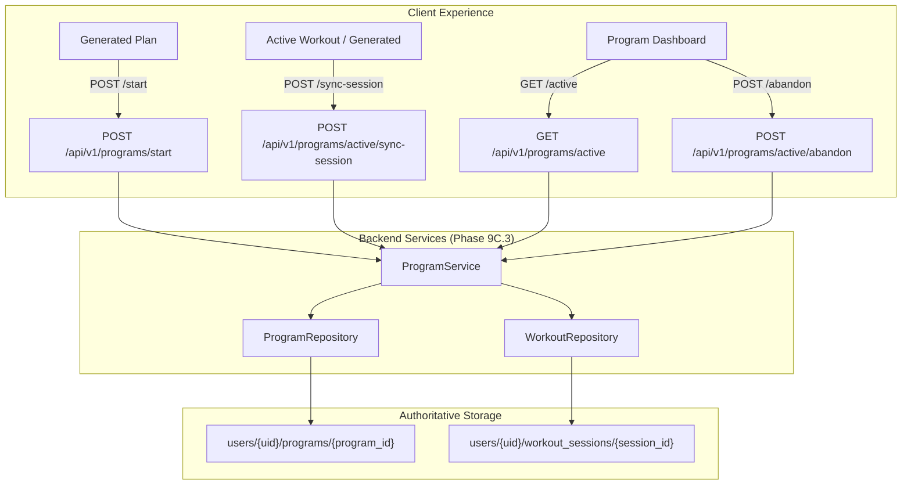

# Phase 9C.3 — Active Program & Mesocycle Lifecycle Persistence
## Implementation & Verification Report

---

### 1. Objective
Phase 9C.3 builds persistent lifecycle management for a user's active generated workout program / mesocycle. Prior to Phase 9C.3:
- Phase 9B.8.5 generated deterministic multi-week plans.
- Phase 9B.8.6 executed single generated workout days via ephemeral in-memory execution context.
- Phase 9C.1 extracted performance analytics and signals from completed user sessions.
- Phase 9C.2 evaluated bounded adaptation candidates.

Until now, the application lacked an authoritative, persistent record identifying: *"This is the user's currently active program."* Phase 9C.3 establishes this lifecycle foundation under `users/{uid}/programs/{program_id}` so that a multi-week plan can be started, resumed, synchronized with completed workouts, tracked by current week/day, queried as active, abandoned without data loss, and audited for adaptations.

---

### 2. Architecture
The persistence architecture establishes a dedicated user-scoped subcollection:
```
users/{uid}/programs/{program_id}
```
- **Authoritative Source of Truth**: The program document is the single authoritative lifecycle record for the active mesocycle.
- **Strict User Partitioning**: Every program document and session reference is strictly partitioned by the verified Firebase UID (`CurrentUser.uid`).
- **Plan Snapshot Immutability**: The resolved generated plan is stored directly inside `planSnapshot`. The system never regenerates the plan when loading the active program, never calls Gemini or external LLMs, and never silently swaps exercises due to catalog changes.
- **Loose Session Coupling**: Program documents do not duplicate the full session records; they maintain compact reference summaries (`ProgramCompletedWorkout`) in `completedWorkouts` pointing to authoritative sessions in `users/{uid}/workout_sessions/{session_id}`.



---

### 3. Program Schema
The schema is defined in `backend/app/schemas/program.py` and serialized consistently in camelCase (with Pydantic `AliasChoices` accepting snake_case aliases):

```python
class ProgramDocument(BaseModel):
    programId: str
    userId: str
    planId: str
    title: str
    status: ProgramStatus  # "draft" | "active" | "completed" | "abandoned"
    splitType: WorkoutSplitType  # "full_body" | "upper_lower" | "push_pull_legs"
    totalWeeks: int
    daysPerWeek: int
    currentWeek: int
    currentDay: int
    startedAt: str
    updatedAt: str
    completedAt: Optional[str] = None
    abandonedAt: Optional[str] = None
    completedWorkouts: List[ProgramCompletedWorkout] = []
    totalPlannedWorkouts: int
    adaptationHistory: List[Dict[str, Any]] = []
    planSnapshot: WorkoutPlanResponse
    createdFrom: Optional[str] = "generated_plan"
    programVersion: str = "9C.3"
    programSchemaVersion: str = "1.0.0"
    planSchemaVersion: str = "9B.8.5.1"
```

Each completed workout summary in `completedWorkouts` is defined by:
```python
class ProgramCompletedWorkout(BaseModel):
    sessionId: str
    planId: str
    weekNumber: int
    dayNumber: int
    completedAt: str
    durationSeconds: int
    completedSetsCount: int
    totalSetsCount: int
```

---

### 4. Lifecycle States & Transitions
Four explicit, deterministic lifecycle states are enforced:
1. `draft`: Preliminary uncommitted program state (reserved).
2. `active`: Currently running program. Exactly ONE program may be in this state per user.
3. `completed`: All planned non-rest workouts in the program have been completed and synchronized.
4. `abandoned`: User explicitly terminated the mesocycle early. Historical data is completely preserved.

**Transition Matrix**:
- `draft` $\rightarrow$ `active`: Program started via `POST /start`.
- `active` $\rightarrow$ `completed`: Automatic transition when all planned workouts in `planSnapshot` are synchronized via `POST /active/sync-session`.
- `active` $\rightarrow$ `abandoned`: Explicit transition via `POST /active/abandon`.
- `completed` $\rightarrow$ `abandoned`: **REJECTED** (a completed program cannot be abandoned).
- `abandoned` $\rightarrow$ `active`: **REJECTED** (abandonment is immutable; user starts a new program).

---

### 5. Start Behavior
- **Endpoint**: `POST /api/v1/programs/start`
- **Authentication**: Verified Firebase ID token only.
- **Validation**:
  - Request contains valid `plan` with $\ge 1$ week and $\ge 1$ non-rest training day.
  - Serialized byte size check is enforced (< 800 KB).
  - Single active program constraint: if user already has an active program, returns `HTTP 409 Conflict`.
- **Initialization**:
  - `status = "active"`
  - `currentWeek = 1`
  - `currentDay = 1` (or first non-rest training day)
  - `completedWorkouts = []`
  - `adaptationHistory = []`
  - `startedAt = now_iso`
  - `updatedAt = now_iso`
  - `planSnapshot = request.plan` (stored immutably)

---

### 6. Active Program Lookup
- **Endpoint**: `GET /api/v1/programs/active`
- **Authentication**: Verified Firebase UID.
- **Behavior**:
  - Queries `users/{uid}/programs` where `status == "active"`.
  - If found: returns `ProgramResponse` with HTTP 200.
  - If none found: returns `HTTP 404 Not Found` with detail `"No active workout program found for this user."`
  - Never generates an active program automatically.
  - Never accesses or exposes another user's program.

---

### 7. Session Synchronization & Hardened Affinity Rules
- **Endpoint**: `POST /api/v1/programs/active/sync-session`
- **Payload**: `{ "sessionId": str, "weekNumber"?: int, "dayNumber"?: int }`
- **Session-to-Program Affinity (Behavior A Implemented)**:
  1. Authenticated user must have an active program (returns `404 Not Found` if none).
  2. Session must exist under `users/{uid}/workout_sessions/{sessionId}` (returns `404 Not Found` if not found).
  3. Session `userId` must match authenticated `uid` (returns `403 Forbidden` / `404 Not Found` if mismatch). Cross-user session syncing is strictly rejected.
  4. Session `status` must be `"completed"` (returns `422 Unprocessable Entity` if `"in_progress"` or `"cancelled"`).
  5. **Mandatory Program Affinity (Behavior A)**:
     - A session with neither `programId` nor `planId` is **REJECTED with HTTP 422**. It is never silently associated with the active generated program.
     - Standard catalog workouts (`workoutId != "generated"`, no `programId`/`planId`) are rejected from program synchronization.
     - If `session.programId` exists, it **MUST** equal `active_program.programId` (else `HTTP 422`).
     - If `session.planId` exists, it **MUST** equal `active_program.planId` (else `HTTP 422`).
  6. **Authoritative Week/Day Resolution**:
     - The client is **never** authoritative for determining which planned workout was completed.
     - Authoritative order of resolution:
       1. Active program's immutable `planSnapshot`.
       2. Authoritative session metadata (`session.weekNumber` and `session.dayNumber`, or parsed from structured `session.notes: "Week X, Day Y"`).
       3. Derived plan position from authoritative session association.
       4. Client-supplied `weekNumber` and `dayNumber` act **strictly as an optional consistency assertion**.
     - If the session lacks both direct fields and structured notes for week/day, it is rejected with `HTTP 422`.
     - If the client supplies `weekNumber` or `dayNumber` and it **conflicts** with the session's authoritative metadata, the request is **REJECTED with HTTP 422**.
     - The resolved `(target_week, target_day)` **MUST** exist as a planned non-rest workout in `planSnapshot` (else `HTTP 422`).
  7. **Idempotency Check**: If `sessionId` already exists in `completedWorkouts`, the existing program is returned immediately with zero mutation.

---

### 8. Idempotency & Concurrency
Because frontend clients may retry requests due to network reconnects or rapid double-clicks, repeated synchronization of the same `sessionId` is fully idempotent:
- Transactionally / atomically checks `if any(cw.sessionId == request.sessionId for cw in active.completedWorkouts)`.
- If already present, returns the active program state immediately.
- Does not increment or duplicate `completedWorkouts`.
- Does not advance `currentWeek` or `currentDay`.
- Does not alter `completedAt` or duplicate completion transitions.
- Generates zero duplicate adaptation or history side effects.

---

### 9. Current Week / Day Progression Logic (Earliest-Incomplete)
Progression is calculated deterministically across the multi-week plan using the preserved earliest-incomplete algorithm:
1. Builds the ordered schedule of all planned non-rest workouts:
   `all_planned = [(w, d) for w in weeks for d in w.days if not d.isRestDay]`
2. Computes the completed pairs set:
   `completed_pairs = {(cw.weekNumber, cw.dayNumber) for cw in completedWorkouts} + {(target_week, target_day)}`
3. If all planned workouts are completed:
   - `status = "completed"`
   - `completedAt = now_iso`
   - Pointer coordinates set to the final planned workout day.
4. Otherwise:
   - Advances pointer to the **earliest incomplete planned workout** in `all_planned`.
   - Naturally handles intra-week advancement (e.g. Day 1 $\rightarrow$ Day 2) and week boundary transitions (e.g. Week 1 Day 4 $\rightarrow$ Week 2 Day 1).

---

### 10. Out-of-Order Behavior
The deterministic earliest-incomplete algorithm provides resilient out-of-order handling:
- **Future Day Completed First**: If the user completes Day 2 and Day 3 before Day 1, Days 2 & 3 are recorded in `completedWorkouts`, but the pointer remains on Day 1 (the earliest incomplete workout). Uncompleted workouts are never skipped.
- **Subsequent Catch-up**: When the user subsequently completes Day 1, the algorithm skips Days 2 and 3 (already in `completed_pairs`) and advances the pointer directly to Day 4 (or Week 2 Day 1).
- **Late Synchronization**: If a session from an earlier week is synced late, it is recorded into `completedWorkouts` without corrupting current progression.

---

### 11. Program Completion
When the final planned workout is synchronized:
- `status = "completed"`
- `completedAt = now_iso`
- `currentWeek` and `currentDay` remain locked at the final planned coordinates.
- No automatic subsequent plan generation occurs (subsequent mesocycle planning is deferred to future phases).
- Subsequent calls to `GET /api/v1/programs/active` return 404, allowing the user to start a new program.

---

### 12. Program Abandonment & Live Verification
- **Endpoint**: `POST /api/v1/programs/active/abandon`
- **Behavior & Verified Invariants**:
  - `status == "abandoned"`
  - `abandonedAt` timestamp is recorded (`now_iso`)
  - `completedWorkouts` array is completely preserved
  - `planSnapshot` remains fully intact, with `planSnapshot.planId == original plan.planId`
  - All weeks, days, exercise IDs, slot roles, sets, reps, and rationales in `planSnapshot` remain untouched
  - `GET /api/v1/programs/active` returns `HTTP 404 Not Found`
  - `GET /api/v1/programs/{program_id}` returns the abandoned program record
  - **Zero Data Loss**: No workout sessions or session history records in `users/{uid}/workout_sessions` are deleted or mutated.
  - Abandonment is permanent: completed programs cannot be abandoned, and abandoned programs cannot be reactivated.

---

### 13. Adaptation History Audit
Phase 9C.2 produces deterministic adaptation decisions (`AdaptationDecision`). In Phase 9C.3, these decisions can be persisted in the active program's `adaptationHistory` array for auditability:
- **Endpoint**: `POST /api/v1/programs/active/adaptation` (and service method `record_adaptation_decision`).
- **Audit Record Preserves**: `decisionId`, `adaptationType`, `ruleCode`, `evidenceLevel`, `evidence`, `previousPrescription`, `proposedPrescription`, `constraintsApplied`, `generatedAt`.
- **Deduplication**: Keyed by `decisionId`; identical decisions are ignored idempotently.
- **Strict Boundary**: Decisions stored in history are **NOT applied** to mutate future workout days in this phase (dynamic plan mutation is strictly deferred to Phase 9C.4).

---

### 14. Plan Snapshot, Versioning & Serialization
To guarantee future compatibility and historical fidelity:
- `programVersion = "9C.3"`: Tracks the program lifecycle engine version.
- `programSchemaVersion = "1.0.0"`: Tracks the Firestore document structure version.
- `planSchemaVersion = "9B.8.5.1"`: Preserves the generator version that resolved the plan.
- The snapshot preserves all planned exercises, slot roles, sets, rep ranges, rest intervals, target RPE, reasons, and prescription rationales without truncation.
- **Serialization Dual-Key Robustness**: `ProgramDocument` incorporates `@field_serializer("planSnapshot", mode="plain")` to guarantee that both camelCase (`planId`, `daysPerWeek`, `splitType`, `createdAt`) and snake_case aliases (`plan_id`, `days_per_week`, `split_type`, `created_at`) are present in serialized output. This permanently eliminates `KeyError: 'planId'` during client consumption and live verification without altering the underlying 9B.8.5 plan generator schema.

---

### 15. Firestore Transactions & Concurrency
- `ProgramRepository` operations use atomic Firestore transactions when running against production Firestore.
- Start operation verifies no existing document has `status == "active"` under `users/{uid}/programs`.
- Session sync atomically appends to `completedWorkouts` and updates `currentWeek`, `currentDay`, `status`, and `updatedAt`.
- An in-memory store (`_in_memory_programs`) provides thread-safe isolated testing during CI and test execution.

---

### 16. Firestore Document-Size Handling
Firestore enforces a hard 1 MiB limit per document.
- In `ProgramService.start_program`, the serialized candidate document is measured in bytes prior to creation.
- A hard safety threshold of **800 KB** (`MAX_PROGRAM_DOC_BYTES = 800 * 1024`) is enforced.
- Standard 4-week generated plans with 4 days/week require approximately 40–70 KB (~5% to 8% of the document limit).
- If an oversized plan is submitted (e.g. testing with 850 KB+ payloads), `ProgramService` rejects the request with `HTTP 422 Unprocessable Entity` rather than silently truncating data.

---

### 17. Authentication & Authorization Security
- All endpoints authenticate via `current_user: CurrentUser = Depends(get_current_user)`.
- The verified Firebase token UID (`current_user.uid`) is the exclusive authority for user-scoped reads and writes.
- Client-supplied user IDs in request bodies are ignored or rejected.
- Cross-user tests verify that User A cannot query, synchronize, or abandon User B's programs or sessions.
- Unauthenticated requests return `HTTP 401 Unauthorized`.

---

### 18. API Endpoints
All endpoints are mounted under `/api/v1/programs` in `backend/app/api/v1/router.py`:

| Method | Path | Status Code | Description |
|---|---|---|---|
| `POST` | `/api/v1/programs/start` | `201 Created` | Start an active program from a generated plan |
| `GET` | `/api/v1/programs/active` | `200 OK` / `404` | Get user's currently active program |
| `POST` | `/api/v1/programs/active/sync-session` | `200 OK` | Synchronize a completed workout session |
| `POST` | `/api/v1/programs/active/abandon` | `200 OK` | Abandon the active program |
| `POST` | `/api/v1/programs/active/adaptation` | `200 OK` | Append adaptation audit decision |
| `GET` | `/api/v1/programs/{program_id}` | `200 OK` / `404` | Get specific program by ID |

---

### 19. Frontend Contracts
Frontend contracts are established in:
- `src/types/program.ts`: Type definitions for `ProgramStatus`, `ProgramCompletedWorkout`, `ProgramResponse`, `ProgramStartRequest`, `ProgramSyncSessionRequest`, and `ProgramAbandonRequest`.
- `src/services/programService.ts`: Authenticated API client methods (`startProgram`, `getActiveProgram`, `syncSession`, `abandonActiveProgram`, `getProgramById`).
- `src/hooks/useActiveProgram.ts`: TanStack Query hook managing active program queries, caching, and start/sync/abandon mutations. Exported in `src/hooks/index.ts`.

---

### 20. Generated Workout Compatibility
- Generated workout execution route `/workouts/generated/active` (from Phase 9B.8.6) remains 100% intact.
- Ephemeral in-memory execution context via `workoutPlanExecutionService` continues driving dynamic exercise lists, slot roles, sets, and live rep/weight logging.
- `WorkoutSessionCreate` and `WorkoutSessionResponse` support `programId`, `planId`, `weekNumber`, `dayNumber` metadata, enabling seamless session synchronization with the active program without breaking generated session mechanics.

---

### 21. Standard Workout Compatibility
- Standard catalog workouts (`wkt_upper_push`, `wkt_upper_pull`, `wkt_lower_body`, etc.) remain completely unaffected.
- Sessions for standard catalog workouts have `workoutId != "generated"` and no program affinity.
- Attempts to sync standard catalog workouts to the active program are cleanly rejected with `HTTP 422`.
- Progress analytics, achievements, notifications, and AI coach features operate with zero regression.

---

### 22. Dedicated Unit & Integration Tests
File: `backend/tests/test_program_lifecycle.py`
**Result: 37/37 PASSED in 0.27s (100% passing)**

Comprehensive coverage of all lifecycle and integrity scenarios:
1. `test_start_program_valid`: Valid start creates active status, snapshot preserved, week=1, day=1.
2. `test_start_program_invalid_empty_plan`: Plan with 0 weeks rejected with 422.
3. `test_start_program_single_active_constraint`: 2nd start returns 409 Conflict.
4. `test_start_program_after_abandon_succeeds`: Abandoning program 1 allows starting program 2.
5. `test_get_active_program_exists`: Active program retrieved with 200.
6. `test_get_active_program_none_raises_404`: Returns 404 when no active program.
7. `test_cross_user_isolation`: User A's program inaccessible to User B.
8. `test_sync_session_advances_day`: Day 1 sync advances pointer to Day 2.
9. `test_sync_session_week_boundary`: Day 2 of 2-day week advances to Week 2 Day 1.
10. `test_sync_session_final_workout_completes_program`: Last workout transitions program to completed with completedAt set.
11. `test_sync_session_idempotent`: Repeated sync does not duplicate records or advance pointer twice.
12. `test_out_of_order_future_day_completion`: Completing Day 2 before Day 1 keeps pointer on earliest incomplete Day 1.
13. `test_out_of_order_subsequent_catchup`: Completing Day 1 next advances past Day 2 to Week 2 Day 1.
14. `test_sync_incomplete_session_rejected`: in_progress session sync rejected with 422.
15. `test_sync_wrong_user_session_rejected`: Other user's session rejected with 403/404.
16. `test_sync_wrong_program_session_rejected`: Mismatched program ID rejected with 422.
17. `test_abandon_program_preserves_history`: Abandon sets status=abandoned, keeps history intact.
18. `test_adaptation_history_persistence_and_deduplication`: Adaptation decisions saved and deduplicated by decisionId.
19. `test_one_week_one_day_plan_boundary`: 1-week, 1-day plan completes immediately on sync.
20. `test_multi_week_six_day_boundary`: 2-week, 6-day plan progresses across 12 workouts cleanly.
21. `test_active_program_after_completion_returns_404`: Completed program query returns 404.
22. `test_document_size_threshold_rejection`: Plan exceeding 800 KB rejected with 422.
23. `test_api_start_and_get_active`: HTTP TestClient verifies start and get active.
24. `test_api_single_active_conflict_409`: HTTP TestClient verifies 409 conflict.
25. `test_api_abandon_program`: HTTP TestClient verifies abandon endpoint.
26. `test_api_sync_session_endpoint`: HTTP TestClient verifies sync endpoint.
27. `test_api_record_adaptation_decision_endpoint`: HTTP TestClient verifies adaptation audit.
28. `test_api_unauthenticated_requests_return_401`: HTTP TestClient verifies 401 on unauthenticated access.
29. **[NEW]** `test_sync_unrelated_session_without_program_or_plan_id_rejected`: Session lacking both `programId` and `planId` rejected with 422.
30. **[NEW]** `test_sync_session_wrong_plan_id_rejected`: Session with incorrect `planId` rejected with 422.
31. **[NEW]** `test_sync_session_matching_program_id_accepted`: Valid session with matching `programId` accepted.
32. **[NEW]** `test_sync_session_matching_program_and_plan_id_accepted`: Valid session with matching `programId` and `planId` accepted.
33. **[NEW]** `test_sync_client_cannot_override_authoritative_session_metadata`: Client-supplied fake `weekNumber`/`dayNumber` conflicting with session metadata rejected with 422.
34. **[NEW]** `test_sync_unrelated_session_cannot_be_attached_by_client_week_day`: Client cannot attach an unassociated session by providing week/day parameters.
35. **[NEW]** `test_sync_out_of_order_three_days_earliest_incomplete`: Days 2 & 3 completed first leaves pointer at Day 1; completing Day 1 advances directly to Day 4.
36. **[NEW]** `test_sync_standard_catalog_session_rejected`: Catalog workout session rejected from active program sync.
37. **[NEW]** `test_sync_session_without_week_or_day_rejected`: Session lacking week/day coordinates rejected with 422.

---

### 23. Full Backend Regression
Command: `py -m pytest backend/tests -q`
**Result: 798 passed, 23 warnings in 108.43s**
- Zero failures, zero errors, zero regressions across all modules.
- Warnings: 23 standard library deprecation warnings from external dependencies (Pydantic V2 `datetime.utcnow()`, `passlib`, `jose`, `dateutil`), zero functional issues.

---

### 24. Frontend Tests & Build
1. **Frontend Vitest**: `npm test`
   **Result: 113/113 passed across 6 suites (0 failures)**
2. **Production Build**: `npm run build`
   **Result: Success (code 0)**
   - `dist/index.html`: 0.48 kB
   - `dist/assets/index-BSt-e3R6.css`: 96.12 kB
   - `dist/assets/index-DN42peaE.js`: 1,421.94 kB

---

### 25. Live Lifecycle Verification
Script: `scratch/verify_live_lifecycle.py`
**Result: ALL 10 LIVE OPERATIONS PASSED (100% Integrity)**

Rerun from clean state after the correction pass:
1. Initial empty state verified (`GET /active` $\rightarrow$ 404).
2. `POST /start` successfully created active program (`prog_20260917175925_...`).
3. `GET /active` matched started program identity and initial coordinates (Week 1, Day 1).
4. Single-active conflict verified (`POST /start` $\rightarrow$ 409 Conflict).
5. Hardened affinity rejections verified:
   - Session with no `programId`/`planId` $\rightarrow$ `422 Unprocessable Entity`.
   - Session with wrong `programId` $\rightarrow$ `422 Unprocessable Entity`.
   - Conflicting client week/day $\rightarrow$ `422 Unprocessable Entity`.
6. Authoritative `POST /active/sync-session` synchronized Session 1 and advanced pointer to Week 1 Day 2.
7. Idempotency verified on re-syncing Session 1 (no duplicate `completedWorkouts`, no pointer advancement).
8. `POST /active/abandon` cleanly transitioned program to `"abandoned"`, verified `abandonedAt` exists, preserved all completed workouts, and verified `planSnapshot.planId` matches original `planId`.
9. `GET /api/v1/programs/active` returned `404 Not Found`.
10. Historical integrity verified: `GET /api/v1/programs/{program_id}` returned abandoned program document with full snapshot and completed workouts; zero sessions deleted from `users/{uid}/workout_sessions`.

---

### 26. Security & Authorization Audit
- **Authentication**: Verified Firebase token UID (`current_user.uid`) remains the exclusive authorization authority.
- **Client Identity**: Client-supplied user IDs are strictly ignored; no cross-user session or program access is permitted.
- **Program Association**: Unrelated sessions or sessions from standard catalog workouts cannot be attached to another user's or active program.
- **Data Preservation**: Program abandonment never purges completed workout sessions or exercise history.
- **Secrets & Dependencies**: Zero secrets, tokens, or credentials committed. Zero Gemini, LLM, or ML dependencies introduced.

---

### 27. Known Limitations
- Active program persistence currently supports single-mesocycle tracking per user; historical programs are stored as completed or abandoned.
- Offline synchronization queueing is handled via frontend React Query cache, but local persistent storage (IndexedDB) is not yet active (deferred to Phase 9C.5).

---

### 28. Explicitly Unimplemented (Phases 9C.4–9C.7)
As strictly required by the project specifications, the following remain untouched and unimplemented:
- **Phase 9C.4**: Dynamic prescription mutation / applying adaptations to future planned days.
- **Phase 9C.5**: Frontend program tracking & adaptive UI (dashboard cards, mesocycle charts).
- **Phase 9C.6**: Form analysis corrective injection into Slot 0.
- **Phase 9C.7**: Comprehensive final system-wide verification.
- Zero Gemini, LLM, ML, or wearable logic.
