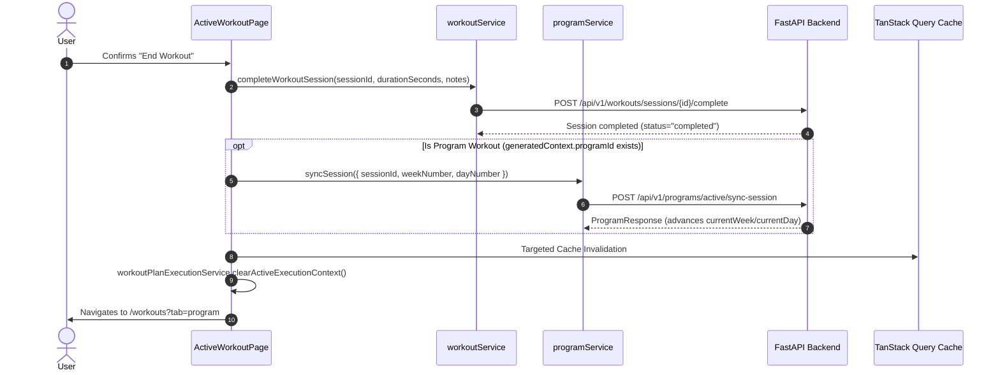

# PHASE 9C.5 — FRONTEND PROGRAM TRACKING & ADAPTIVE UI
## CORRECTED ARCHITECTURE ASSESSMENT & IMPLEMENTATION PLAN

**Phase**: 9C.5  
**Domain**: Frontend Program Tracking, Adaptive Mesocycle Progression & Execution Handshake  
**Status**: ARCHITECTURE ASSESSMENT & PLAN ONLY (Phase 9C.4 is CLOSED and APPROVED)  
**Implementation State**: **FROZEN** (Phase 9C.5 implementation remains frozen pending user approval of this corrected architecture assessment)  
**Author**: Antigravity AI Engineering  
**Workspace**: `c:\Users\Suchit\Downloads\Fitness App`  

---

## 1. ARCHITECTURAL OBJECTIVE & CORE RESPONSIBILITY BOUNDARIES

Phase 9C.5 establishes the user-facing program-tracking and execution-integration experience for persistent, adaptive workout programs.

```
User
  ↓
Active Program
  ↓
Current Week / Day
  ↓
Today's Effective Prescription (Authoritative API)
  ↓
Workout Execution (ActiveWorkoutPage)
  ↓
Completed Session
  ↓
Authoritative Sync Session Handshake (POST /programs/active/sync-session)
  ↓
Backend Advances Pointers & Updates Mesocycle State
  ↓
Targeted TanStack Query Invalidation
  ↓
Frontend Reflects Authoritative State
```

### 1.1 Strict Responsibility Boundaries

The frontend remains strictly a **presentation, interaction, and execution-triggering layer**.

- **Backend Authority**:
  - Program lifecycle state (`draft`, `active`, `completed`, `abandoned`).
  - Active pointers (`currentWeek`, `currentDay`).
  - Session completion and mesocycle history (`completedWorkouts`).
  - Effective workout prescriptions for any week/day (`EffectivePrescriptionResponse`).
  - Plan versioning (`planVersion`: 1 → 2 → 3...) and audit trail (`adaptationHistory`).
  - Personalization signals and progression evaluations.
  - Progression decisions, qualification thresholds, and safety bounds.

- **Frontend Prohibitions (Strict Invariants)**:
  - The frontend must **NEVER** calculate, evaluate, or invent adaptation decisions.
  - The frontend must **NEVER** allow the user to manually manufacture, edit, or submit an `AdaptationDecision`.
  - The frontend must **NEVER** expose an "Apply Adaptation" user button or action.
  - The frontend must **NEVER** calculate progression increments, volume cuts, or deltas client-side.
  - The frontend must **NEVER** fabricate explanation text or invoke LLMs/Gemini.
  - The frontend must **NEVER** determine why an adaptation occurred; it only displays the deterministic `ruleCode`, `deltaMagnitude`, `previousPrescription`, `proposedPrescription`, and `rationale` provided by the backend.

---

## 2. CORRECTED ROUTING ARCHITECTURE

### 2.1 Sole Active Program Route: `/workouts?tab=program`

The existing `/workouts` hub is the single frontend home for all workout features:
- All Workouts (standard catalog)
- Generate Plan (multi-week planner)
- **Active Program** (`/workouts?tab=program`)
- Custom Workouts
- Favorites
- History

### 2.2 Explicit Route Prohibitions
To avoid route fragmentation and maintain clean architecture, Phase 9C.5 will **NOT** introduce:
- `/program`
- `/active-program`
- `/my-program`
- `/workouts/program` (explicitly removed from all proposals)

### 2.3 Tab Integration in `WorkoutsPage`
- In `src/components/workout/WorkoutsFilterTabs.tsx`, the tab list is updated:
  ```ts
  const tabs = ['All Workouts', 'Generate Plan', 'Active Program', 'Custom Workouts', 'Favorites', 'History']
  ```
- In `src/pages/app/WorkoutsPage.tsx`:
  - Reads `searchParams.get('tab')`. If `tab === 'program'`, `activeTab` is set to `'Active Program'`.
  - When the user has an active program (`hasActiveProgram === true`) and no search param is specified, the default tab can prioritize `'Active Program'`.
  - Clicking the `'Active Program'` tab updates URL search params to `?tab=program` via `setSearchParams({ tab: 'program' })`.
  - Deep-linking through `/workouts?tab=program` directly lands the user on their active program.

---

## 3. ADAPTATION TRIGGER & APPLICATION BOUNDARIES

### 3.1 Boundary Between Phases 9C.2, 9C.4, and 9C.5

- **Phase 9C.2 (Deterministic Adaptation Engine)**:
  - Generates bounded, deterministic adaptation proposals (`AdaptationDecision`) strictly from 9C.1 performance signals and completed sessions.
  - Read-only evaluation layer.
- **Phase 9C.4 (Adaptation Application & Versioning)**:
  - Validates and applies approved 9C.2 decisions to future workouts in `effectivePlanSnapshot`.
  - Increments `planVersion` (1 → 2) and records audit trail in `adaptationHistory`.
  - Authoritative endpoint: `POST /api/v1/programs/active/apply-adaptation`.
- **Phase 9C.5 (Frontend Program Tracking & Adaptive UI)**:
  - **Presentation and execution only.**
  - Consumes and displays the resulting backend state (`planVersion`, `isAdapted`, `appliedAdaptations`, `adaptationHistory`).
  - Does **NOT** orchestrate adaptation evaluations.

### 3.2 Authoritative Finding on Automatic Adaptation Triggering
- **Audit Finding**: Inspection of `backend/app/services/program_service.py` confirms that `sync_session` only advances mesocycle pointers and appends completed sessions. It does **NOT** automatically invoke `apply_adaptation`.
- **Authoritative Statement**:
  > **Automatic adaptation triggering/orchestration is outside Phase 9C.5 and will not be introduced in this phase.**
  Phase 9C.5 will NOT add adaptation orchestration or automatic triggers into `WorkoutsPage`, `ActiveProgramView`, `ActiveWorkoutPage`, `TodayWorkoutCard`, or React Query hooks.
  The frontend only PRESENTS adaptations that have already been applied by the authoritative backend pipeline (e.g. via backend administration, automated service pipelines, or verification tests).

---

## 4. SINGLE SOURCE OF TRUTH FOR EFFECTIVE PRESCRIPTIONS

### 4.1 Strict Invariant: Effective Prescription Endpoint Authority
For any active-program workout that the user previews, views, or executes:

$$\mathbf{GET\ /api/v1/programs/active/prescription/\{week\}/\{day\}}$$

is the **SOLE authoritative source of truth** for:
- Exercise selection and canonical IDs
- Exercise order
- Slot roles (`warmup_corrective`, `primary_compound`, `secondary_compound`, etc.)
- Prescribed set count
- Target rep ranges (`target_reps_min`, `target_reps_max`, `target_reps`)
- Target RPE
- Prescribed rest intervals (seconds)
- Working resistance / weight (kg), including adapted loads
- Adaptation indicators (`isAdapted: true`, `is_adapted: true`)
- Prescription rationale and recommendation reasons

### 4.2 Prohibition of Local Snapshot Fallbacks
- Individual frontend components must **NEVER** independently choose between:
  ```ts
  // FORBIDDEN PATTERN:
  const day = program.effectivePlanSnapshot?.weeks[w]?.days[d] ?? program.planSnapshot.weeks[w].days[d]
  ```
- The following components must **NEVER** treat `planSnapshot` as an alternative source of truth for an active workout:
  - `TodayWorkoutCard`
  - `ActiveProgramView`
  - `ProgramDayCard`
  - `ActiveWorkoutPage`
  - `workoutPlanExecutionService` (execution context)
- Program-level snapshots (`planSnapshot`, `effectivePlanSnapshot`) may only be used for macro metadata/overview (e.g. total weeks, split type, total planned workouts).
- All workout execution data must come strictly from `GET /api/v1/programs/active/prescription/{week}/{day}`.

### 4.3 Explicit Error Handling Invariant
If a prescription cannot be loaded:
- The UI must render an explicit `ErrorState` with a retry button.
- The UI must **NEVER** silently substitute the original `planSnapshot`.
- The UI must **NEVER** substitute mock workouts or static catalog data (`wkt_upper_push`).

---

## 5. EXECUTION HANDSHAKE & SESSION AFFINITY

### 5.1 Execution Context Data Model Enhancement
In `src/services/workoutPlanExecutionService.ts`, `GeneratedWorkoutExecutionContext` is enhanced to carry unambiguous program affinity:

```ts
export interface GeneratedWorkoutExecutionContext {
  programId?: string        // Authoritative active program ID
  planId: string            // Generated plan ID
  planTitle: string         // Human-readable plan title
  splitType: WorkoutSplitType // Split taxonomy
  weekNumber: number        // 1-indexed week number
  dayNumber: number         // 1-indexed day number
  phaseLabel: string        // Mesocycle phase label
  day: PlannedWorkoutDay    // Authoritative PlannedWorkoutDay from effective prescription
  baseWorkoutId?: string    // Legacy router compatibility fallback
}
```

### 5.2 Session Creation Handshake
When entering `ActiveWorkoutPage` in generated/program mode:
1. It reads `generatedContext`.
2. Passes `programId`, `planId`, `weekNumber`, and `dayNumber` to `workoutService.startWorkoutSession`:
   ```ts
   await startSession(
     'generated',
     notes,
     workoutTitle,
     totalPlannedSets,
     generatedContext.programId,
     generatedContext.planId,
     generatedContext.weekNumber,
     generatedContext.dayNumber
   )
   ```
3. `POST /api/v1/workouts/generated/sessions` creates the session in Firestore with authoritative metadata:
   ```json
   {
     "workoutId": "generated",
     "workoutTitle": "Upper Body Strength Routine",
     "totalSetsCount": 16,
     "notes": "Generated Plan: ...",
     "programId": "prog_20260918_abc123",
     "planId": "pln_def456",
     "weekNumber": 1,
     "dayNumber": 1
   }
   ```

### 5.3 Session Completion & Program Synchronization Handshake
When the user clicks "End Workout" in `ActiveWorkoutPage`:


### 5.4 Safety Guards in ActiveWorkoutPage
- **Zero Static Fallback**: If `:id === 'generated'` but `generatedContext` is missing (e.g. direct URL visit or hard refresh), `ActiveWorkoutPage` renders an explicit `EmptyState` ("No Active Generated Plan Found") with a button to return to `/workouts?tab=program`. It **never** falls back to static catalog routines.

---

## 6. QUERY & CACHE ARCHITECTURE (TanStack Query)

### 6.1 Authoritative Query Keys & Namespaces

```ts
// Active program metadata, pointers, status, and completedWorkouts
export const ACTIVE_PROGRAM_QUERY_KEY = ['activeProgram']

// Authoritative effective prescription for a specific week and day
export const effectivePrescriptionQueryKey = (week: number, day: number) =>
  ['activeProgramPrescription', week, day]

// Program versions, applied adaptations count, and audit history
export const PROGRAM_VERSIONS_QUERY_KEY = ['programVersions']

// Personalization signals (read-only)
export const personalizationSignalsQueryKey = (windowDays: number = 28) =>
  ['personalizationSignals', windowDays]

// Single exercise performance summary (read-only)
export const exercisePerformanceSignalQueryKey = (exerciseId: string) =>
  ['exercisePerformanceSignal', exerciseId]

// Currently active session (execution layer)
export const ACTIVE_SESSION_QUERY_KEY = ['activeSession']
```

### 6.2 Cache Settings
- `['activeProgram']`: `staleTime: 60 * 1000` (1 minute).
- `['activeProgramPrescription', week, day]`: `staleTime: 5 * 60 * 1000` (5 minutes).
- `['programVersions']`: `staleTime: 5 * 60 * 1000` (5 minutes).
- `['personalizationSignals', windowDays]`: `staleTime: 5 * 60 * 1000` (5 minutes).
- `['activeSession']`: `staleTime: 0` (always validated).

### 6.3 Targeted Query Invalidation Matrix

| Event | Queries Invalidated | Queries Removed / Set Directly |
| :--- | :--- | :--- |
| **Session Sync** (`syncSession`) | `['activeProgram']`<br>`['activeProgramPrescription']`<br>`['personalizationSignals']`<br>`['progressSummary']`<br>`['workoutHistory']` | `['activeSession']` set to `null` |
| **Program Start** (`startProgram`) | `['activeProgram']`<br>`['activeProgramPrescription']`<br>`['programVersions']` | `['activeProgram']` set to new program |
| **Program Abandon** (`abandonProgram`) | `['activeProgram']` | `['activeProgram']` set to `null`<br>Remove `['activeProgramPrescription']`<br>Remove `['programVersions']` |
| **External Adaptation Applied** (detected via version bump) | `['activeProgram']`<br>`['activeProgramPrescription']`<br>`['programVersions']` | *None* |

---

## 7. ADAPTATION STATUS & AUDIT PRESENTATION

### 7.1 Structured Adaptation Display
When an active program has `planVersion > 1` or entries in `adaptationHistory`:
- The UI renders an **"Active Program Adaptation"** card.
- Displays strictly deterministic fields supplied by the backend:
  - **Program Version**: e.g., `Plan Version 2 (v2)`
  - **Rule Code & Label**:
    - `DOUBLE_PROGRESSION_LOAD_INCREASE` → "Double Progression: Working Load Increase"
    - `VOLUME_FATIGUE_ACCUMULATION` → "Volume Fatigue: Working Sets Reduced"
    - `REP_PROGRESSION_ISOLATION` → "Rep Range Progression"
  - **Affected Exercise**: e.g., "Barbell Back Squat"
  - **Prescription Comparison (Before vs After)**:
    - *Previous*: `3 sets × 8 reps @ 100.0 kg`
    - *Updated*: `3 sets × 8 reps @ 102.5 kg (+2.5 kg)`
  - **Deterministic Rationale**: Formatted directly from `adaptationRecord.rationale` and `adaptationRecord.reasons`.
  - **Applies To**: "All future workouts containing this exercise in Weeks 2–4."
  - **Audit Timestamp**: ISO date formatted locally.

### 7.2 Adaptation History Section
- Backed by `GET /api/v1/programs/active/versions`.
- Displays a chronological list of applied adaptations:
  - Version (`v1 → v2`)
  - Date & time
  - Exercise name
  - Change magnitude (`+2.5 kg`, `-1 set`)
  - Rule identifier
  - Reversibility status (`isReversible: true`)

---

## 8. PROGRAM TIMELINE & WEEK VIEW

### 8.1 Weekly Mesocycle Navigator
- Week selector tabs: `Week 1`, `Week 2`, `Week 3`, `Week 4`.
- Shows week number, phase label (e.g. `Accumulation Phase`), and total weekly sets.

### 8.2 Authoritative Day Card States
Every day in the selected week is assigned one of four mutually exclusive states based strictly on authoritative program data:

1. **`COMPLETED`**:
   - Condition: `program.completedWorkouts.some(cw => cw.weekNumber === w && cw.dayNumber === d)`
   - Visual: Muted card border, green checkmark icon (`CheckCircle2`), completion timestamp, duration.
2. **`CURRENT / TODAY`**:
   - Condition: `w === program.currentWeek && d === program.currentDay && program.status === 'active'`
   - Visual: Emerald accent border (`border-emerald-500`), glowing `TODAY'S WORKOUT` badge.
   - Action: Primary "Start Workout" button (`Play` icon).
3. **`UPCOMING`**:
   - Condition: Day index occurs after current pointer and is not completed.
   - Visual: Slate card, "Upcoming" badge, target muscles and patterns.
   - Action: "Preview Routine" (loads effective prescription in preview mode).
4. **`REST DAY`**:
   - Condition: Day is marked `isRestDay: true` in the split.
   - Visual: Muted card, moon icon, "Rest & Recovery".

---

## 9. PROGRAM PROGRESS & INSIGHTS

### 9.1 Authoritative Progress Display
- Progress is driven strictly by backend counts:
  - `completedWorkoutsCount = program.completedWorkouts.length`
  - `totalPlannedWorkouts = program.totalPlannedWorkouts`
  - `currentPosition = Week ${program.currentWeek} of ${program.totalWeeks} • Day ${program.currentDay} of ${program.daysPerWeek}`
- Presentation Arithmetic:
  ```ts
  const completionPercentage = totalPlannedWorkouts > 0
    ? Math.min(100, Math.round((completedWorkoutsCount / totalPlannedWorkouts) * 100))
    : 0
  const remainingWorkouts = Math.max(0, totalPlannedWorkouts - completedWorkoutsCount)
  ```

### 9.2 Minimum Useful Performance Signals
- Backed by `GET /api/v1/personalization/signals`.
- Displayed in a collapsible "Program Performance Insights" panel:
  - Training Consistency (`frequencyConsistency` %, e.g. `88%`)
  - Load Progression Summary (recent compound lift increases)
  - Rep Completion Rate (`repCompletion` %, e.g. `95%`)
- Purely read-only; does not duplicate `/progress`.

---

## 10. ERROR, LOADING & EMPTY STATES (ZERO FABRICATION RULE)

- **Loading State**: Clean, structural `Skeleton` placeholders matching the header, week pills, and day cards.
- **No Active Program**:
  - `GET /api/v1/programs/active` returns 404 (or `null`).
  - Renders `EmptyState`: "No Active Program", description explaining personalized mesocycles, and a primary CTA "Generate Workout Plan" (switches tab to `'Generate Plan'`).
  - Never silently creates a program.
- **API Error State**:
  - Network/server error loading program or prescription:
  - Renders `ErrorState` with "Failed to load program data" and a "Retry" button.
  - **Zero Fabrication Invariant**: An API failure must NEVER render mock workouts, fake progressions, or static catalog workouts.
- **Missing Execution Context**:
  - Visiting `/workouts/generated/active` without context renders an explicit `EmptyState` ("No Active Generated Session") with CTA to return to `/workouts?tab=program`.

---

## 11. RESPONSIVE DESIGN & ACCESSIBILITY (WCAG 2.1 AA)

### 11.1 Target Screen Breakpoints
- **Desktop Large (`1536×1024`, `1440×900`, `1280×800`)**:
  - 12-column layout. Left 8 cols: Program overview, Week selector, Day cards, Today's prescription. Right 4 cols: Progress card, Adaptation status card, Program insights.
- **Tablet (`1024×768`, `768×1024`)**:
  - Responsive 2-column or stacked layout. Horizontal scrollable week selector.
- **Mobile (`430×932`, `390×844`)**:
  - Single column. "Today's Workout" card is anchored at top.
  - Days rendered as stacked cards or horizontal scroll pills.
  - Zero horizontal page overflow.

### 11.2 Accessibility Standards
- Semantic heading hierarchy: `<h1>` for Program Title, `<h2>` for Week Timeline & Today's Workout, `<h3>` for Exercise names.
- Keyboard navigation: All interactive buttons and tabs accessible via `Tab` and `Enter` with visible focus rings (`focus-visible:ring-2 focus-visible:ring-emerald-500`).
- ARIA semantics: `aria-current="step"` on today's workout day, `aria-modal="true"` on modals.
- Color contrast: All text exceeds 4.5:1 ratio against dark slate backgrounds. Day status communicated via text and icons, never color alone.

---

## 12. SECURITY & AUTHENTICATION INTEGRITY

- All API requests use Firebase ID tokens retrieved via `getIdToken()` and transmitted via `Authorization: Bearer <token>`.
- Client requests never send `userId` in URLs or bodies; UID is extracted strictly from verified server-side JWTs.
- Zero client-side storage of sensitive credentials or API keys.
- Replay protection ensured by backend idempotency on `start-program`, `sync-session`, and `abandon`.

---

## 13. IMPLEMENTATION SUBPHASES (7-SUBPHASE SEQUENCE)

### Subphase 9C.5.1 — Frontend Program Contracts & Data Layer (READ/SESSION/LIFECYCLE)
- **Objective**: Extend domain types, harden API client services, and implement TanStack Query hooks. Strictly read/session/lifecycle oriented.
- **Scope**:
  - `src/types/program.ts`: Update types for prescription and versions.
  - `src/services/programService.ts`: Ensure `getActiveProgram`, `getEffectivePrescription`, `getProgramVersions`, `startProgram`, `syncSession`, `abandonActiveProgram` are strongly typed.
  - `src/services/workoutService.ts`: Add optional `programId`, `planId`, `weekNumber`, `dayNumber` to `startWorkoutSession`.
  - `src/hooks/useActiveProgram.ts`: Implement `useActiveProgram`, `useEffectivePrescription`, `useProgramVersions`, and targeted query cache invalidations.
  - **Explicit Exclusion**: Does NOT expose `applyAdaptation` as a user-facing hook or mutation.
- **Tests**: Service unit tests, query key tests, invalidation tests.

### Subphase 9C.5.2 — Active Program Overview & Week Tracking UI
- **Objective**: Build the core Active Program dashboard view, program header card, weekly mesocycle timeline, and day status cards under `/workouts?tab=program`.
- **Scope**:
  - `src/components/workout/program/ActiveProgramHeader.tsx` [NEW]
  - `src/components/workout/program/ProgramWeekTimeline.tsx` [NEW]
  - `src/components/workout/program/ProgramDayCard.tsx` [NEW]
  - `src/components/workout/program/ActiveProgramView.tsx` [NEW]
  - `src/components/workout/WorkoutsFilterTabs.tsx` [MODIFY: add 'Active Program' tab]
  - `src/pages/app/WorkoutsPage.tsx` [MODIFY: handle `?tab=program` and render `ActiveProgramView`]
- **Tests**: Component unit tests for day status mapping, week switching, and progress percentage arithmetic.

### Subphase 9C.5.3 — Effective Prescription & Execution Integration
- **Objective**: Connect today's authoritative effective prescription to execution. Enhance `TodayWorkoutCard` on dashboard and `ActiveProgramView` to launch workouts with program affinity, and execute the `syncSession` handshake upon completion.
- **Scope**:
  - `src/services/workoutPlanExecutionService.ts` [MODIFY: add `programId`, `dayNumber` to context]
  - `src/components/workout/program/TodayPrescriptionCard.tsx` [NEW]
  - `src/components/dashboard/TodayWorkoutCard.tsx` [MODIFY: dynamic active program integration]
  - `src/pages/app/ActiveWorkoutPage.tsx` [MODIFY: session start with program affinity & completion `syncSession` call]
- **Tests**: Integration tests for prescription loading, execution context handover, session start payload with `programId`, and session completion calling `syncSession`.

### Subphase 9C.5.4 — Adaptation Status & History UI
- **Objective**: Implement the structured "Program Progression Applied" alert card and the chronological adaptation audit history drawer/modal.
- **Scope**:
  - `src/components/workout/program/AdaptationUpdateCard.tsx` [NEW]
  - `src/components/workout/program/AdaptationHistoryModal.tsx` [NEW]
  - `src/components/workout/program/ProgramInsightsDrawer.tsx` [NEW]
- **Tests**: Unit tests for delta formatting, deterministic reason rendering, and history list mapping.

### Subphase 9C.5.5 — Program Lifecycle Management & Empty States
- **Objective**: Handle "Start Active Program" from plan generator, accessible Abandon Program confirmation modal, Mesocycle Completed banner, and empty states.
- **Scope**:
  - `src/components/workout/plan/GeneratedWorkoutPlanView.tsx` [MODIFY: add "Start Active Program" button]
  - `src/components/workout/program/AbandonProgramModal.tsx` [NEW]
  - `src/components/workout/program/ProgramCompletedBanner.tsx` [NEW]
- **Tests**: Lifecycle transition tests: start program -> active -> abandon -> empty -> start new program.

### Subphase 9C.5.6 — Responsive Polish & Accessibility (WCAG 2.1 AA)
- **Objective**: Responsive optimization across all 7 target screen sizes, keyboard navigation, visible focus indicators, ARIA attributes, and color contrast validation.
- **Scope**:
  - Styling refinements across all `src/components/workout/program/` components.
- **Tests**: Responsive layout tests, keyboard navigation tests, ARIA role validation.

### Subphase 9C.5.7 — Comprehensive Frontend Verification & Regression Suite
- **Objective**: Full end-to-end frontend test suite covering all 9C.5 flows, verifying zero regressions across existing 113 frontend tests and all backend tests.
- **Scope**:
  - `src/tests/activeProgram.test.tsx` [NEW]
  - `src/tests/activeProgramExecution.test.tsx` [NEW]
- **Tests**: Complete frontend test suite execution (`npm test`), build validation (`npm run build`).

---

## 14. TESTING STRATEGY

### Unit Tests
- `ProgramDayCard`: Correctly renders `COMPLETED`, `CURRENT`, `UPCOMING`, and `REST` states based on authoritative props.
- `ActiveProgramHeader`: Renders program title, split, week/day position, and progress bar percentage without NaN.
- `AdaptationUpdateCard`: Formats load, set, and rep deltas without modifying source values. Renders deterministic rule labels.
- `TodayPrescriptionCard`: Lists all prescribed exercises, target sets, reps, and RPE.

### Service & Hook Tests
- `programService`: Validates Bearer token attachment, 404 mapping to null, 409 conflict handling, and JSON serialization.
- `useActiveProgram`: Verifies TanStack Query keys, cache invalidations on sync and abandon, and loading/error states.
- `useEffectivePrescription`: Verifies authoritative fetch by week/day with caching.

### Integration Tests
- Active Program → Prescription → Execution Context Handshake.
- `ActiveWorkoutPage` session completion → `syncSession` execution → query invalidation → next day becomes current.
- Program start from generated plan → active program view transition.
- Program abandon → query cache cleared → empty state rendered.

### Regression & Build Verification
- All 113 existing frontend tests must continue passing with zero failures.
- All 82+ backend program lifecycle and adaptation tests must continue passing.
- TypeScript build (`npm run build` / `tsc`) must succeed with zero errors.

---

## 15. 21-STEP MANUAL BROWSER QA PLAN

1. Sign in with authenticated user.
2. Navigate to `/workouts`.
3. If no active program, verify "No Active Program" empty state with "Generate Workout Plan" CTA.
4. Click CTA, configure split (e.g. Upper/Lower 4-week), and generate plan.
5. Click "Start Active Program". Verify instant transition to Active Program view (`/workouts?tab=program`).
6. Verify Program Title, Split badge, Duration (4 Weeks), and Plan Version (`v1`).
7. Verify Week 1 is selected, with Day 1 marked as `TODAY'S WORKOUT` (emerald border).
8. Verify Days 2–4 marked as `UPCOMING`.
9. Click "Start Today's Workout". Verify seamless transition to `/workouts/generated/active`.
10. Verify exercise list matches Day 1 effective prescription.
11. Complete all sets with recorded weights and reps.
12. Click "End Workout" and confirm in modal.
13. Verify automatic return to `/workouts?tab=program`.
14. Verify Day 1 is now marked as `COMPLETED` (green checkmark) and Day 2 is now `TODAY'S WORKOUT`.
15. Verify Progress Bar reflects `1 of 16 Workouts Completed (6%)`.
16. Trigger legitimate backend adaptation (via 9C.2 / 9C.4 double progression).
17. Refresh program view; verify Plan Version updates to `v2` and "Program Progression Applied" card appears.
18. Open Day 3 prescription; verify adapted exercise displays updated load (+2.5 kg).
19. Test mobile layout at 390×844; verify zero horizontal scroll and clean card stacking.
20. Test keyboard navigation (`Tab`, `Enter`, `Escape` on modals); verify visible focus rings.
21. Open browser console; verify zero unhandled exceptions or React key warnings.

---

## 16. EXPLICIT OUT-OF-SCOPE BOUNDARIES

The following are strictly **OUT OF SCOPE** for Phase 9C.5:
- **Phase 9C.6**: Form Analysis & Corrective Exercise Injection (Slot 0 alterations).
- **Phase 9C.7**: Comprehensive Multi-Mesocycle Verification & End-to-End Hardening.
- **Machine Learning / Gemini**: Zero LLM calls for adaptation reasoning or explanation generation.
- **Biometric Wearables**: Heart rate monitors, Apple Health, Whoop integrations.
- **Autonomous Coaching**: Spontaneous workout modifications without backend adaptation rules.
- **New Adaptation Schedulers / Orchestrators**: No automated client-side triggers for 9C.4.
- **Catalog Content Changes**: No additions or modifications to the static exercise catalog.

---

## 17. EXACT FILES EXPECTED TO CHANGE IN SUBPHASE 9C.5.1

- `src/types/program.ts` (type refinements for prescription and versions)
- `src/services/programService.ts` (query and mutation helpers)
- `src/services/workoutService.ts` (support `programId`, `planId`, `weekNumber`, `dayNumber` in `startWorkoutSession`)
- `src/hooks/useActiveProgram.ts` (add `useEffectivePrescription`, `useProgramVersions`, query invalidations; strictly READ/SESSION/LIFECYCLE oriented)

---

## 18. CONFIRMATION OF ZERO IMPLEMENTATION

**I confirm that NO implementation of Phase 9C.5 has been performed.**
- No frontend source code modified.
- No backend source code modified.
- No tests created or modified.
- No package dependencies installed.
- No environment files altered.
- No database entries changed.

**Phase 9C.5 implementation remains frozen pending user approval of this corrected architecture assessment.**
